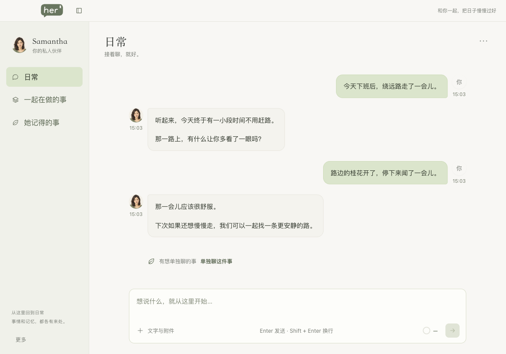
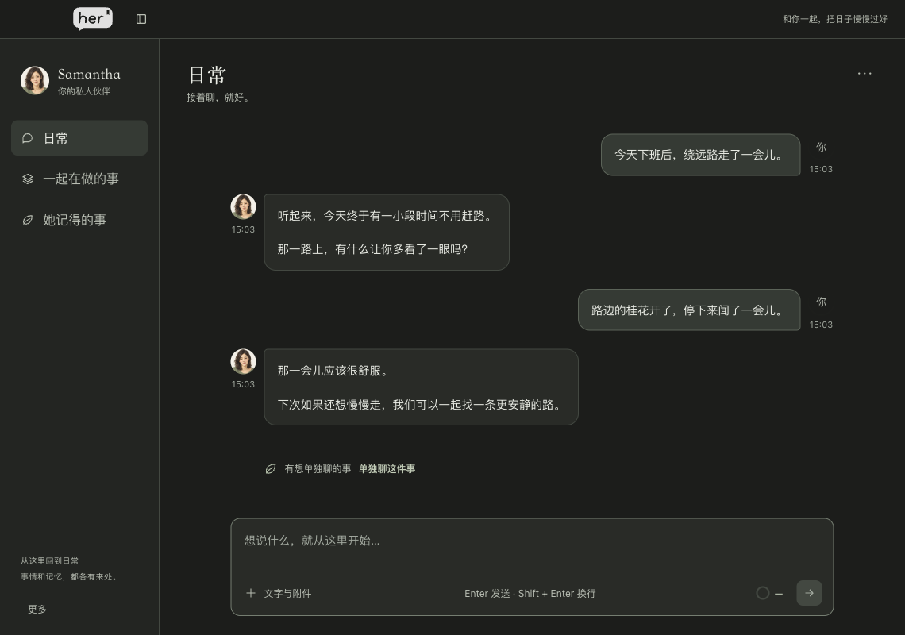
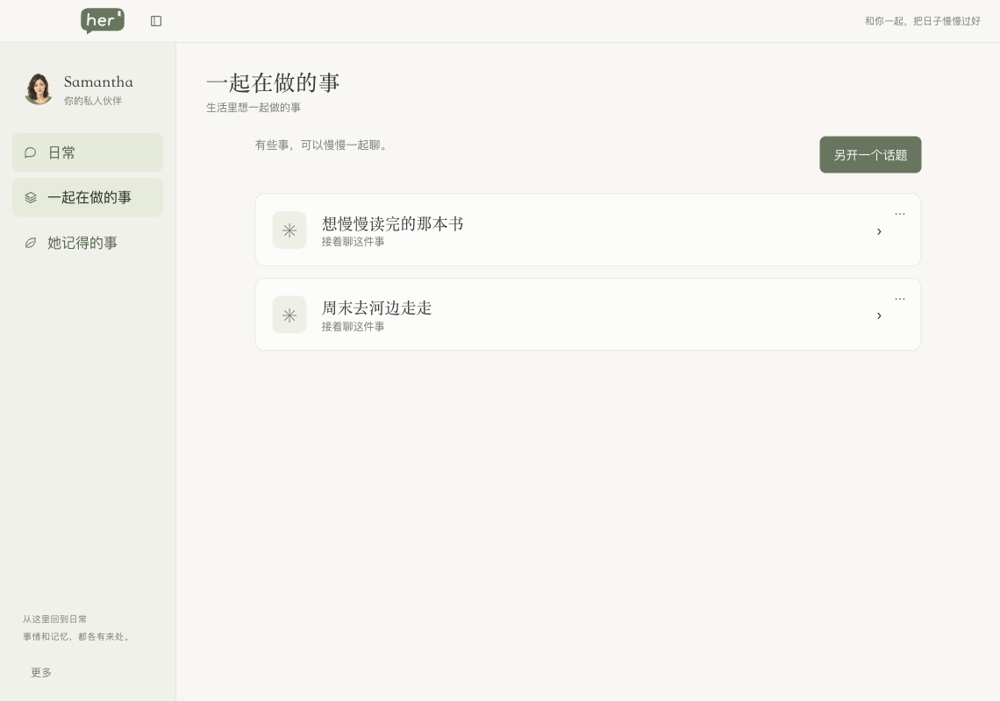
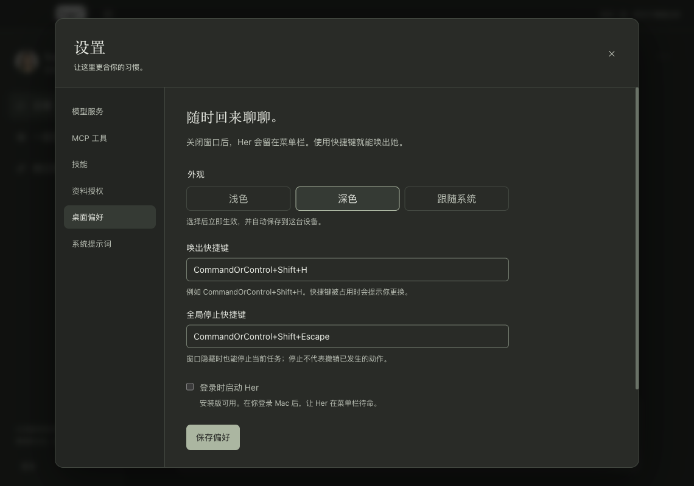

# Her

Her 是以日常相处与生活陪伴为主的私人 AI 伙伴，内置助手名为 **Samantha**，名字来自电影《Her》中的 AI 助手。

当前版本为 **0.2.0**，使用 Electron、React 和 TypeScript 构建桌面界面，以 [Pi 智能体 SDK](https://github.com/earendil-works/pi/blob/v1.3.0/packages/coding-agent/docs/sdk.md) 承担模型执行、会话历史与上下文压缩。模型使用你配置的服务，聊天历史与应用配置保存在本机。

## 界面预览

日常里接着聊，也可以把一件想认真讨论的小事单独留下来。



<details>
<summary>查看更多：夜间模式、生活话题与桌面偏好</summary>

**深色日常**：暖炭灰背景，保留文字、消息与输入区的层次。



**一起在做的事**：把散步、读书等生活话题各自留下，之后再继续聊。



**桌面偏好**：浅色、深色、跟随系统，以及唤出与停止快捷键。



</details>

以上截图来自实际运行的 Her 0.2.0 Electron 应用，使用隔离的演示对话与本地模拟模型服务，不包含真实用户资料；截图不代表长期记忆或外部工具任务已经执行。

## 当前可用

- 「日常」持续聊天，「一起在做的事」管理具体话题；可预览选定交流，再确认带入新话题。
- 自定义 OpenAI Chat Completions、OpenAI Responses、Claude / Anthropic Messages 兼容服务的地址、模型、密钥和额外请求头。
- 独立检测文字流式连接与完整工具调用能力；工具测试只检测协议，不执行业务操作。
- 流式文字、Markdown、图片与文档附件、停止生成、失败重试、切换模型、上下文用量和压缩。
- 同一会话内持久排队，不同会话可并行；工具审批、委托范围、暂停与继续、未知结果核实。
- Pi 会话文件保存对话历史，SQLite 保存配置、任务、队列与展示投影；重启恢复记录，未完成任务等待处理。
- 话题重命名、回收站、恢复与永久删除；浅色、深色和跟随系统外观。
- 菜单栏入口、关闭窗口后后台运行、可配置唤出快捷键和登录自启设置入口；源码运行暂不支持开启登录自启。

「她记得的事」目前是未开放说明页，尚未交付长期记忆能力。语音、定时提醒、主动联系、虚拟世界、临时聊天和数据导出恢复也仍属于后续方向。当前界面范围见[生活陪伴界面设计](docs/superpowers/specs/2026-10-23-life-companion-ui-design.md)。

## 智能体框架：Pi

[Pi](https://github.com/earendil-works/pi) 是开源的智能体工具集，提供统一模型 API、智能体执行循环，以及可嵌入应用的 TypeScript SDK。Her 使用 SDK 在 Electron 主进程内创建会话，将这些执行能力接入生活陪伴界面；安装 Her 的项目依赖即可使用，不需要另外全局安装 Pi CLI。

Her 当前精确锁定 `@earendil-works/pi-coding-agent@1.3.0` 与 `@earendil-works/pi-ai@1.3.0`。上游支持的全部模型、CLI 功能和扩展不等于 Her 已经开放的能力，Her 的接入范围以本仓库实现为准。

| 层次 | 使用的组件 | 在 Her 中的职责 |
| --- | --- | --- |
| 模型适配 | `@earendil-works/pi-ai` | 连接所选模型服务，处理模型协议与流式响应 |
| 智能体会话 | `@earendil-works/pi-coding-agent` | 执行循环、工具调用事件、会话历史、上下文重建与压缩 |
| 产品运行时 | Her 的 `AgentHost` 与工具门 | 请求接纳、持久队列、任务身份、权限审批、资源冲突、动作账本、附件来源与桌面交互 |

Pi 的 `SessionManager` 管理 JSONL 会话历史，SQLite 中的消息是可重建的展示投影。Her 显式注入系统提示词、模型配置和受控工具，不直接开放 Pi 默认的文件、Shell 等编程工具，也不读取用户主目录下的 Pi 配置。实现入口见 [`factory.ts`](src/core/agent/factory.ts) 与 [`host.ts`](src/core/agent/host.ts)，适配边界见 [Pi 适配设计](docs/superpowers/specs/2026-10-19-her-pi-adapter-design.md)。

感谢 Pi 项目及其维护者提供智能体基础设施。相关上游资料：

- [Pi 项目与源代码](https://github.com/earendil-works/pi)
- [Pi TypeScript SDK：会话、工具与模型接入（v1.3.0）](https://github.com/earendil-works/pi/blob/v1.3.0/packages/coding-agent/docs/sdk.md)
- [Pi AI：统一模型 API（v1.3.0）](https://github.com/earendil-works/pi/blob/v1.3.0/packages/ai/README.md)
- [Pi 会话文件格式（v1.3.0）](https://github.com/earendil-works/pi/blob/v1.3.0/packages/coding-agent/docs/session-format.md)
- [Pi 的 MIT 许可证](https://github.com/earendil-works/pi/blob/v1.3.0/LICENSE)

## 安装与运行

需要 macOS、Node.js 24 或更新版本和 npm。在项目目录运行：

```bash
npm install
npm run dev
```

开发模式会监听主进程与预加载脚本的修改，并自动重启应用或重载窗口；界面修改继续热更新。开发窗口打开后，在“设置 → 模型服务”添加一个服务即可聊天。构建后启动：

```bash
npm run build
npm start
```

`build` 生成 `out/main`、`out/preload`、`out/renderer`。`npm run package` 先构建，再用固定 `@electron/packager@20.3.0` 生成当前 Mac 架构的 `release/Her-darwin-arm64/Her.app`（arm64 示例），bundle ID 为 `com.her.desktop`。本机包不执行签名、公证、上传或发布。首次打包需要下载 Electron；网络受限时可使用下文的 `ELECTRON_MIRROR` 环境变量。

| 命令 | 用途 |
| --- | --- |
| `npm run package` | 构建并生成当前 Mac 架构的本地 .app |
| `npm run typecheck` | TypeScript 检查 |
| `npm test` | 核心与界面自动化测试 |
| `npm run check` | 类型检查、全部单测、构建 |
| `npm run test:e2e` | 构建并启动实际 Electron 做端到端测试 |

当前 Electron 版本在首次运行时下载二进制。若下载出现连接超时、连接重置等网络错误，先重试或更换可访问 GitHub 的网络；必要时使用 [Electron 官方安装文档](https://www.electronjs.org/zh/docs/latest/tutorial/installation)列出的第三方镜像，显式运行下载脚本：

```bash
ELECTRON_MIRROR="https://npmmirror.com/mirrors/electron/" node node_modules/electron/install.js
```

## 配置模型服务

1. 打开“设置 → 模型服务 → 添加服务”，填写服务名称、协议、Base URL 和服务支持的 Model ID。
2. 按服务要求填写 API Key，或在“额外请求头”中填写字符串键值的 JSON 对象，保存服务。
3. 分别运行“测试文字”和“测试工具”，然后点击“设为当前”或从聊天窗口右上角选择服务。

**Base URL 应包含服务要求的 API 路径前缀。** Her 去掉末尾斜杠后追加资源路径，不自动补 `/v1`，也不要填写完整的聊天接口地址：

| 协议 | Base URL 示例 | 实际请求路径 |
| --- | --- | --- |
| OpenAI 兼容 | `https://example.com/proxy/v1` | `/proxy/v1/chat/completions` |
| OpenAI Responses | `https://example.com/proxy/v1` | `/proxy/v1/responses` |
| Claude / Anthropic | `https://example.com/proxy/v1` | `/proxy/v1/messages` |

地址支持 HTTP / HTTPS，不接受 URL 用户名、密码、查询参数或片段；认证信息请放在 API Key 或额外请求头。OpenAI 默认发送 `Authorization: Bearer ...`，Anthropic 默认发送 `x-api-key` 和 `anthropic-version: 2023-06-01`。额外请求头可以覆盖同名默认头，例如第三方网关要求的版本或项目标识：

```json
{
  "X-Project": "my-project"
}
```

已保存的密钥和请求头不会回显。编辑时留空会保留原值；输入新值会替换，勾选“清除已保存的密钥”或“清除已保存的请求头”才明确清除。修改协议、地址、模型或凭据后，需要重新测试。

连接测试使用已保存配置，并会向所选服务发送小型测试请求；文字通过不表示工具能力通过。工具不支持时仍可文字聊天。请求失败会显示错误，Her 不会自动改发其他端点，也不会跟随携带凭据的 HTTP 重定向。

## 工具、文件与外部依赖

“设置 → MCP 工具”支持本地 stdio 和远程 Streamable HTTP。静态 Token/请求头由主进程加密；留空保留，显式清除才删除。连接测试证明发现工具，不代表目标应用或浏览器已经获得权限。仅支持 OAuth 登录的服务目前不能按静态凭据接入；prompts、sampling 与工具自己的嵌套 agent 不在首版范围。

- Mac 操作使用固定 Peekaboo 4.9.3。按预设指引分装依赖，由用户为实际执行宿主授予辅助功能/屏幕录制权限；换成安装包后应重新检查权限状态。
- 浏览器操作使用内置 ego-browser 技能与本机官方 CLI，通过独立任务空间操作浏览器。执行前须读取完整运行指南，脚本经过 Her 的工具审批；使用说明见[内置技能](src/core/skills/ego-browser/SKILL.md)。
- open-webSearch 2.2.0 为默认关闭的可选预设；启用后使用请求式公开检索，不复用 Chrome 登录态。
- 文档读取使用 MarkItDown 0.1.8 / MCP 0.0.1a7，支持 PDF、DOCX、PPTX、XLSX 等文字/表格提取，不保证复杂版式、物理页码或 Excel 公式重算。扫描页和图表由本地 PDF.js 按页渲染后交给当前视觉模型；能力不足会提示切换，不会自动换模型或端点。

依赖单独安装，Her 管理自己启动的工具进程。安装版的固定 npm 清单位于 `Her.app/Contents/Resources/mcp-web-dependencies/`，文档安装脚本与 74 包哈希锁位于 `Her.app/Contents/Resources/dependencies/markitdown/`；每个目录含安装说明。无需源码仓库，不捆绑外部 Node/Python、浏览器或研究虚拟环境。源码版对应 `resources/` 下相同目录。详细版本、安装命令与限制见[兼容记录](docs/implementation/her-tools-v1-compatibility.md)。依赖检查保存真实可执行路径，GUI 启动无需继承终端 PATH。

缺少工具或版本不符时，在“设置 → MCP 工具 → 从预设添加”选择工具并检查依赖，按结果中的官方下载按钮和安装步骤操作。网页工具和文档解析器提供“复制安装命令”，命令会使用当前 Her 的资源路径；复制后在终端运行，完成后点击“重新检查依赖”。下载或复制不会直接显示已安装。已保存的预设有“检查服务依赖”，连接失败时也会补充这些指引；“设置 → 资料授权 → 检查解析器依赖”提供同样的 MarkItDown 安装入口。macOS 权限与浏览器登录、授权状态仍需在实际运行环境核实。

添加资料即授权当前对话读取；目录可授权本次对话或长期使用。长期授权可在设置撤销，临时资料可在当前对话撤销；读取权限不包含修改原文件。读取、缓存、图片与来源打开均重新检查授权，撤销不撤回已经发送给模型的历史内容。新文档最多 50 MiB，文本分段最多 30,000 字符；PDF 每次最多 3 页、长边 2,000 像素，以物理页序定位。

同一会话同时执行一个任务，后续消息进入持久队列；不同会话可以并行，桌面或同一写入目标等冲突资源单独排队。发送、删除、覆盖和不明确操作先确认；停止立即阻止后续步骤，已经发生的动作不会自动回滚。默认全局停止键为 `Command+Shift+Escape`，可在桌面偏好更换；冲突会提示，聊天停止按钮一直可用。连续运行最多 40 次工具调用或 10 分钟活动时间，等待确认不计时。重启保留记录但不自动续做；继续任务会保留轨迹，未知结果需先观察或人工处理，不能直接重复派发。

真正退出会取消任务、最多等待 5 秒清理连接并终止 Her 自己启动的子进程，不关闭用户 Chrome。卸载 `.app` 不自动删除数据：先退出 Her，再按设置显示的目录备份/删除应用自管数据库、附件和缓存。分别安装的依赖在 `~/.local/share/her/dependencies/`；不再使用时可自行删除对应版本目录，MarkItDown 所依赖的 uv Python 仍被其他环境使用时应保留。永久删除会话会清理其专属资料，长期授权和其他会话仍引用的资料保留；不会删除用户源文件。

实际验收与模拟服务证据分别列在[Tools V1 验收记录](docs/implementation/her-tools-v1-acceptance.md)。

## 历史与桌面行为

数据集中在 Electron 应用专用 `userData` 下的 `Her-Pi-v1/`，macOS 默认位置为 `~/Library/Application Support/Her/Her-Pi-v1/`；实际位置可在“设置 → 桌面偏好”查看。Pi 会话历史位于 `pi/sessions/`，配置、任务、队列和展示投影位于 `her.sqlite`。普通历史与配置没有整库加密；API 密钥及额外请求头由 Electron `safeStorage` 加密后保存，macOS 使用系统钥匙串支持的保护方式，保护不可用时不会改存明文。

重启会恢复历史。模型上下文由 Pi 会话与压缩机制管理，Her 按所选模型的上下文容量设置压缩预算；完整历史仍留在本机，这不等同于长期记忆。取消或失败的回答会保留已生成片段与运行状态，重试创建新的尝试并保留原失败记录。

关闭窗口会隐藏窗口并保持后台运行。通过菜单栏“显示 Her”、Dock 或快捷键可以再次唤出；默认快捷键为 Mac 的 `Command+Shift+H`，可以在桌面偏好中更换，冲突时会提示。应用菜单或菜单栏中的“退出 Her”才结束应用，未完成的回答会标记中断。开发模式使用 Electron 应用壳；运行打包后的 `Her.app`，系统应用名称显示为 `Her`。

登录自启默认关闭。当前源码运行尝试开启时会提示需要安装版；[Electron 文档](https://www.electronjs.org/docs/latest/api/app#appsetloginitemsettingssettings-macos-windows)说明 macOS 自启依赖打包、签名和公证，后续仍需系统实测，不能将设置入口视为已验证的自启能力。

## 验证边界

本仓库使用 Vitest 验证核心逻辑与界面组件，使用 Playwright 启动实际 Electron 做端到端测试。模型一侧使用独立的本地 HTTP 模拟服务，每次测试创建临时数据目录，验证桌面应用、协议与本地持久化链路，不使用个人聊天资料或用户真实第三方账户。具体结果以当前执行的检查与验收记录为准。

自动化验收不替代对你所用模型服务的验证，使用前请在应用中分别测试所选服务。早期验收记录见[Stage A 实施说明](docs/implementation/stage-a.md)，Pi 适配进度与验证项目见[当前任务清单](openspec/changes/adopt-pi-agent-runtime/tasks.md)。

## 后续方向

以下是长期设计方向，不代表当前版本已经可用；具体范围和实施次序以对应设计、任务清单与验收为准。

- **长期个人记忆**：有来源依据的偏好、经历与重要人物记忆，支持纠正、限制使用和遗忘。见[记忆产品设计](docs/superpowers/specs/2026-10-23-companion-memory-product-design.md)。
- **语音相处**：本地语音识别、语音合成、打断与通话管理。
- **提醒与主动联系**：在明确许可与时段内提供提醒和有依据的主动交流。
- **共同场景**：虚拟地点、共同活动与可收起的世界面板。
- **数据保护与整理**：临时聊天、笔记产物、手动备份与导出恢复。
- **移动端与同步**：桌面核心功能稳定后的 iOS/iPadOS 体验与跨设备同步。

更完整的早期愿景见[产品与技术设计](docs/superpowers/specs/2026-10-13-her-design.md)。Pi 适配进度以 [OpenSpec 任务清单](openspec/changes/adopt-pi-agent-runtime/tasks.md) 为准。

## 文档

- [完整产品与技术设计](docs/superpowers/specs/2026-10-13-her-design.md)
- [Stage A 实施计划](docs/superpowers/plans/2026-10-13-her-stage-a.md)
- [Stage A 实施与验收说明](docs/implementation/stage-a.md)
- [AI 助手开发指南](AGENTS.md)
- [前端设计规范](docs/DESIGN_SYSTEM.md)
- [生活陪伴界面设计](docs/superpowers/specs/2026-10-23-life-companion-ui-design.md)
- [Pi 适配设计](docs/superpowers/specs/2026-10-19-her-pi-adapter-design.md)
- [Pi 适配任务清单](openspec/changes/adopt-pi-agent-runtime/tasks.md)
