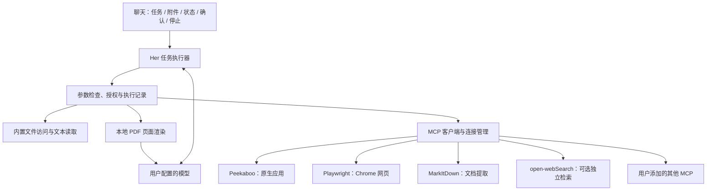

# Her 首版工具能力范围与接入方案

日期：2026-10-15  
状态：产品设计已定稿，用户已确认 Q4–Q9；实现进行中。功能与验证进度以实施任务总览为准。  
实施入口：[任务总览与依赖](../plans/2026-10-15-her-tools-v1.md)。

2026-10-22 设计补充：[私人伙伴交互设计 Q5](2026-10-22-private-companion-interaction-design.md#q5明确的最终消息指令可以构成批准)允许对象唯一、最终内容完整且目标已核对的普通消息发送由用户指令直接批准，省去重复点击；删除、覆盖及其他动作不据此改变确认规则。本补充为已确认的新设计，尚未实施。

本文整理本次讨论的工具能力首版：在现有聊天之上，让 Her 能操作 Mac、使用网页、读取本地资料，并通过设置扩展 MCP 服务。语音、记忆、提醒与虚拟世界继续沿用各自设计和实施安排。

**一、已经确认的设计依据**

| 决定 | 首版要求 |
| --- | --- |
| 操作原生 Mac 应用 | 打开应用、观察目标窗口、点击、输入，首先接入 Peekaboo MCP |
| MCP 客户端 | 首版实现；设置里可以添加其他 MCP 服务 |
| 连续执行 | 接到任务后连续推进；发送、删除、覆盖前确认；用户可以停止 |
| 观察数据 | 按需把目标窗口截图和可见文字交给配置的模型 |
| 文件授权（Q8） | 添加文件即允许当前对话读取；文件夹支持本次对话或长期授权；长期授权可撤销 |
| 扫描 PDF（Q9） | 首版支持按需将相关页面交给当前视觉模型识别；不支持视觉时明确提示 |
| 前台接管（Q4） | 任务需要时允许使用前台焦点及共享输入；展示操作目标，提供全局停止快捷键 |
| 依赖交付（Q5） | 依赖分别安装，Her 检查并引导；本地工具进程由 Her 管理 |
| 模型选择（Q6） | 桌面、浏览器和文档任务沿用当前聊天模型；能力不足时提示用户切换，不自动更换端点 |
| 搜索服务（Q7） | Playwright 连接现有 Chrome，承担默认网页搜索与操作；open-webSearch 保留为默认关闭的可选预设 |

2026-10-13 的总设计曾将通用电脑操控排除在首版外；本次用户明确提出首版接入 Peekaboo 和 MCP，相关工具范围以本次新决定为准。文件读取授权不自动增加对原文件的写入授权。

**二、首版能力清单**

| 能力 | 用户可以做什么 | 接入方案 | 范围与状态 |
| --- | --- | --- | --- |
| Mac 操作 | 打开指定应用，读取目标窗口，点击、输入、滚动，观察执行结果 | Peekaboo MCP | 支持必要的前台接管；不承诺所有应用都支持后台操作 |
| 网页搜索与操作 | 搜索资料、打开结果、引用来源，读取登录后的网页，填写表单 | Playwright MCP + 官方 Chrome 扩展 | 接现有 Chrome 和获准的标签范围，复用登录状态 |
| 独立网页检索 | 按关键词获取多引擎结果与公开网页内容 | open-webSearch MCP | 可选预设，默认关闭；用户启用后可作为独立搜索路径 |
| 本地文件查找 | 列目录，按文件名或文本关键词查找，查看文件信息 | Her 内置文件工具 | 按会话/长期授权执行；限定返回数量，避免一次扫描和返回整个磁盘 |
| 文本读取 | 阅读 TXT、Markdown、代码、JSON、CSV、日志 | Her 内置文本工具 | 分段读取、关键词定位，保留来源文件和读取范围 |
| 普通文档阅读 | 总结和比较 PDF、DOCX、PPTX、XLSX 的文字或表格 | MarkItDown MCP | 内容提取；复杂版式和公式不作完整保真承诺 |
| 扫描件阅读 | 识别扫描 PDF 相关页、混合 PDF 中未提取的图像内容 | Her 本地 PDF 按页渲染 + 当前视觉模型 | 已确认纳入；按需识别，标明识别结果与不确定部分 |
| 图片理解 | 分析用户提供的图片和执行所需的截图 | 现有图片消息链路扩展 | 工具截图还需接入模型上下文；普通网页结构操作无需每步看图 |
| 外部工具扩展 | 添加、测试、启停和删除 MCP 配置，查看可用工具 | Her MCP 客户端 | 已确认；兼容范围按实际协议、认证方式与版本声明 |

首版文件能力以查找和读取为主。修改原文件、移动/重命名、批量删除、生成并编辑 Word/Excel/PPT 等，不因本次文件读取决定而成为交付承诺。桌面任务中用户明确要求的提交或修改动作，仍遵守逐目标确认策略。

**三、工具分工和调用顺序**

按任务选择最直接的能力：文件内容直接读文件；网页内容和交互优先浏览器工具；原生应用、系统窗口交给 Peekaboo。普通文档先提取文字；需要理解扫描页或图表时补充图像。切换工具后重新观察目标，不复用另一工具的元素编号或坐标。

首版每次运行一个任务，避免两个工具同时操作同一个窗口或标签页。模型规划步骤，Her 统一执行与记录；工具服务负责具体动作。首版不开放工具服务自己的嵌套 agent 或任意脚本执行来绕过 Her 的调度；预设使用允许清单，隐藏的工具在执行入口同样拒绝。网页暴露的动态 WebMCP 工具默认关闭。

**四、MCP 接入与依赖交付**

MCP 客户端和本地文件访问放在 Electron 主进程，界面通过类型化 IPC 获取状态和提交配置。复用现有工具注册表，给不同服务的工具分配稳定且互不冲突的名称。

| 连接类型 | 首版支持 | 用户需要提供 |
| --- | --- | --- |
| 本地 stdio | 启动子进程，通过标准输入/输出调用；日志走独立通道；真正退出应用时清理自管进程 | 命令、参数，按需设置工作目录和环境变量 |
| 远程 Streamable HTTP | 工具发现与调用、连接测试、超时/取消、断线提示 | 服务 URL，以及服务要求的静态 Token 或请求头 |

首版以 tools 发现和调用为核心，覆盖文本、图片、结构化数据及明确的错误结果。采用 SDK 并固定验证过的版本，不宣称支持所有 MCP 协议版本或可选能力。结果中的资源链接可以展示，但首版不自动获取未知资源；具体内容读取需经过已实现的受控文件/网页入口。其他未支持的内容类型明确标识。

远程 HTTP 的静态凭据接入不等于支持所有 OAuth 服务。完整 OAuth 登录、服务商应用注册以及 prompts、sampling 等扩展不列为默认首版承诺；遇到仅支持尚未实现认证方式的服务，应明确提示。后续接具体服务时增加相应适配。[MCP 架构说明](https://modelcontextprotocol.io/docs/learn/architecture)

预设如下；安装包或命令均在实施时固定到实际验证的版本，保存发布版本、协议和工具清单兼容记录，不直接把 GitHub main 文档当成发布包事实：

| 预设 | 运行方式 | 必要准备 |
| --- | --- | --- |
| Peekaboo | 本地 `peekaboo mcp --allow-foreground`，stdio | 安装 Peekaboo；向实际执行宿主授予所需 macOS 权限；核验宿主与服务版本匹配 |
| Chrome 浏览器 | 本地 Playwright MCP，使用 `--extension` | Node/npm、Chrome、官方扩展、浏览器连接授权 |
| 文档读取 | 本地 `markitdown-mcp`，默认 stdio | 受支持的 Python 运行时、包及相应格式依赖 |
| open-webSearch | 本地 npm 包，显式设置 `MODE=stdio` | Node/npm、可访问搜索引擎的网络；无需搜索 API Key |

本地进程由 Her 启停管理，用户无需手动保持终端或另外部署服务器。首版依赖分别安装；首次使用检查依赖，展示缺失项和安装指引，缺少依赖仅停用对应能力。GUI 启动时不假设继承终端 PATH；保存验证过的可执行文件路径。首版提供本机可运行的 macOS 应用包，签名、公证和自动更新不属于本次工具能力交付。

Peekaboo 当前提供 stdio，内置 HTTP/SSE 服务尚未实现；默认使用 MCP 进程自有生命周期，若使用外部 Bridge，必须显式指定并核验宿主。具体前后台能力需以固定版本验证。[Peekaboo MCP](https://github.com/openclaw/Peekaboo/blob/main/docs/MCP.md)、[启动参数](https://github.com/openclaw/Peekaboo/blob/main/docs/commands/mcp.md)

Playwright 官方扩展可接已有 Chrome 登录状态，用户选择标签页，当前支持按客户端标签组管理可见范围；连接审批由扩展处理，Her 的业务动作确认另行执行。[Chrome 扩展](https://github.com/microsoft/playwright/blob/main/packages/extension/README.md)

**五、文件与文档的数据流**

1. 用户选择文件，或给当前对话/长期使用授权一个目录。
2. Her 检查实际路径与授权范围，包含规范化和符号链接目标检查；临时授权绑定会话，长期授权可撤销。
3. 文本文件按段读取；文档经 MarkItDown 适配层提取；大型结果保留在本地，模型按需读取相关片段。
4. 对无法提取文字或需要视觉理解的 PDF 页面，Her 在本地渲染页面图像，再调用当前视觉模型。混合 PDF 按页补充识别。
5. 回答附来源文件和实际可用的位置线索。PDF 图像识别记录物理页序；印刷页码另存，不混用。普通解析结果没有页码时，用章节或原文片段定位。
6. 解析缓存关联文件版本，文件变化后重新提取。撤销授权后，后续读取和缓存使用均重新检查；撤销访问不自动抹除已经发送的历史消息。

MarkItDown MCP 的公开工具是 `convert_to_markdown(uri)`，本身不提供按页图像渲染接口；PDF 页面渲染必须由 Her 额外实现。其进程可以访问自身有权限的文件及网络资源，因此内置文档入口只接受经 Her 检查的文件，不向模型无条件开放原始 URI 转换工具。[MarkItDown MCP](https://github.com/microsoft/markitdown/blob/main/packages/markitdown-mcp/README.md)

文件授权是 Her 文件入口的访问规则，不是整个 Mac 的系统沙箱。用户自行添加的 MCP 和桌面操作有各自权限，设置界面应清楚展示它们的连接与权限范围。

文本提取和 PDF 渲染优先在本地完成；用于回答的文本片段、图片或截图会发送给用户配置的模型。模型无视觉能力、文档加密、提取失败或仅识别部分内容时，明确返回实际状态。

**六、执行体验与必要的运行时补齐**

聊天展示正在执行的步骤、目标应用/网页/文件、结果和失败原因。任务状态至少包括执行中、等待确认、已停止、完成和失败；单个动作还需要记录“结果未知”，避免把超时当作未执行。

- 发送、删除、覆盖前展示具体目标和内容/变更摘要；确认绑定本次参数与观察，目标变化后重新判断。
- 停止立即阻止后续步骤，尽力取消当前调用；已经执行的外部动作不承诺撤销。
- 写操作超时、取消或失联后先观察当前状态，不能重放整段任务。只读调用可以进行有界重试。
- 通用 click/type 本身不能可靠表达业务风险；结合用户意图与最新界面判断，动作或目标不清时进入确认。MCP annotations 只作参考。
- 截图必须真正进入模型输入，并保留对应的 snapshot、目标窗口及坐标信息；不把图片结果压成一段字符串。
- 工具返回、网页和文档内容作为任务资料，不能自行改变用户授权或替代用户的确认。
- 工具循环需要有界的步骤、时间和输出限制；达到限制时保存进展并说明下一步，不盲目继续。这里是执行保护，不新增费用上限。

当前代码已具备基础串行工具循环和取消信号，但固定为 5 轮，工具结果只支持字符串；重试会清空工具记录后重跑。接入外部动作前要一起调整这些行为。对应位置：`src/core/conversation/chat.ts`、`src/core/tools/types.ts`、`src/shared/types.ts`、`src/core/providers/stream.ts`。

当前附件入口及模型上下文实际只支持图片；文档接入还需修改文件选择入口、文件引用/缓存与模型上下文组装，不能只增加上传扩展名。

**七、设置入口**

| 区域 | 用户可见内容 |
| --- | --- |
| 工具与连接 | 预设服务、添加自定义 MCP、启停、编辑、移除、测试连接、工具列表、连接状态和诊断 |
| 本地文件 | 长期授权目录、撤销入口；当前会话显示临时授权的资料 |
| 电脑操作 | macOS 权限检查、目标应用与执行状态、前台接管提示、可配置的全局停止快捷键 |
| 文档读取 | 解析器可用状态、缺失依赖、视觉模型能力提示 |

本地配置提供命令、独立参数列表、工作目录和环境变量；远程配置提供 URL 和认证字段。密钥在主进程加密保存，日志隐藏凭据。表单沿用现有草稿保护，连接测试结果不得覆盖用户正在编辑的配置。

修改或停用服务后，新的调用立即使用当前状态；已等待确认的旧调用不得绕过停用或配置变化。关闭窗口可保持后台任务；显式退出负责停止任务并清理自管工具进程，不关闭用户自己的 Chrome。

**八、实施顺序与验收标准**

| 顺序 | 工作 | 通过标准 |
| --- | --- | --- |
| 1 | 工具运行时与 MCP 客户端 | 能发现/调用工具，正确处理文字和图片，取消、确认及未知结果状态可验证 |
| 2 | Peekaboo 接入 | 打开指定应用，观察、输入、重新观察；发送前确认；停止后无后续动作；实际 Mac 权限和宿主验证通过 |
| 3 | 搜索与浏览器 | Playwright 连接获准的 Chrome 标签页，完成搜索、阅读和表单填写；显式启用 open-webSearch 后可独立搜索并引用来源 |
| 4 | 本地文件与普通文档 | 目录内查找、读取、文档比较；未授权路径拒绝；长期授权重启后有效，撤销后缓存不能绕过 |
| 5 | 扫描 PDF | 全扫描和混合 PDF 按页识别，来源页序正确；无视觉模型和部分失败给出清楚提示 |
| 6 | 设置和综合场景 | 添加一个兼容的自定义 MCP，完成连接测试/启停；真正退出无遗留自管进程；真实模型、浏览器和本机联调通过 |

文档样例至少覆盖文字 PDF、扫描 PDF、混合 PDF、DOCX、PPTX、多个工作表的 XLSX、中文长文本。Excel 首版验收表格内容提取，不把模型计算当作公式重算能力。单元测试和模拟服务只能证明本地逻辑，真实模型图片工具结果、真实 macOS 权限与打包应用需要单独验证。

**九、工程默认值与兼容要求**

这些默认值用于实现和测试，可通过后续实测调整，不新增费用上限：

| 项目 | 首版默认值 |
| --- | --- |
| 并发执行 | 全局 1 个任务；任务内工具串行 |
| 执行上限 | 每次连续运行最多 40 次工具调用、10 分钟活动时间；等待用户确认的时间不计入；达到上限进入暂停并显示部分结果 |
| 单次工具超时 | 普通工具 60 秒；文档提取 120 秒；取消或超时的写操作记录结果未知 |
| 返回内容 | 每次最多向模型返回 30,000 个文本字符；每张工具图片最多 10 MiB；超限明确报错或截断并标记，不能静默丢弃 |
| 文件读取 | 新文档最大 50 MiB；目录列表每页最多 100 项；文本每次最多 30,000 字符；保留现有图片附件限制 |
| PDF 图像 | 单次最多渲染 3 页，长边最多 2,000 像素；物理页序从 1 开始；不一次渲染整本文档 |
| 停止快捷键 | 默认 CommandOrControl+Shift+Escape，可修改；冲突明确提示，聊天停止按钮始终可用 |
| 退出清理 | 取消任务后最多等待 5 秒关闭自管连接；随后只终止 Her 拥有的子进程，再关闭数据库 |
| 凭据与配置 | 主进程加密保存；空字段保留，显式清除；配置 revision 变化后旧测试结果和旧确认失效 |

任务状态单独持久化，兼容现有 SQLite v4 和四种消息状态。旧工具字符串结果仍可显示；执行记录在动作派发前落盘，重启不会自动续做。用户选择继续时保留原轨迹，重新观察未知动作。每次运行固定当前模型和配置版本；变更模型后通过新的继续操作生效。

图片与解析缓存保存到应用自管目录并以引用进入记录，避免大段 base64 反复写入聊天 JSON。会话永久删除时清理其专属资料、临时授权和缓存引用，保留其他会话仍引用的数据和长期目录授权。缺失的缓存不得伪装为可读；从源文件恢复前重新检查授权。

**十、实施任务**

产品选项 Q4–Q9 均已确认，无待定的产品范围。具体依赖版本由实施任务完成兼容验证并锁定；若验证证明已选路线无法满足本设计，记录证据后再提出替代，不静默降低验收标准。

- [任务总览、共享接口与依赖](../plans/2026-10-15-her-tools-v1.md)
- [A：工具执行与 MCP 基础，T01–T06](../plans/2026-10-15-her-tools-v1-runtime.md)
- [B：桌面、浏览器与交付验收，T07–T08、T13](../plans/2026-10-15-her-tools-v1-integrations.md)
- [C：文件与文档读取，T09–T12](../plans/2026-10-15-her-tools-v1-files.md)

补充来源：[open-webSearch 的 stdio 配置与能力](https://github.com/Aas-ee/open-webSearch)、[MarkItDown 支持的格式与提取目标](https://github.com/microsoft/markitdown)。
