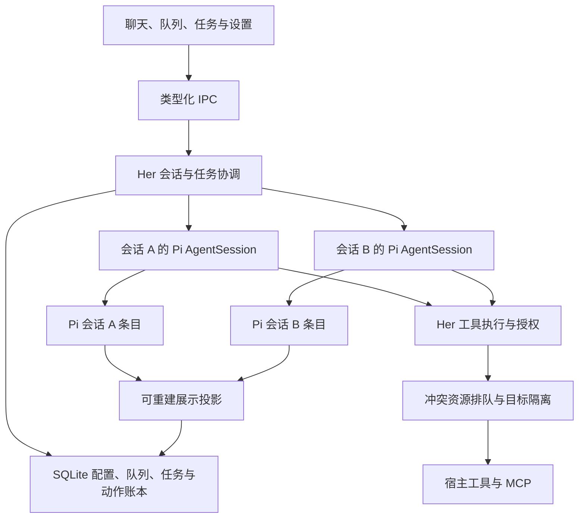

# Her Pi 运行底座适配设计

状态：Q1–Q16 产品决策已确认，完整方案待用户最终确认；尚未开始产品代码实施。

日期：2026-10-19。本文区分用户决定、工程选择和需要验证的 SDK 能力。工程选择随本文交付审阅，不描述为用户逐项指定的实现。

## 1. 目标与范围

Her 使用 Pi 完整会话 SDK 作为 Agent 底座，承接持续增长的对话，复用上游模型适配、Agent 循环、会话重建和自动压缩能力。取消按固定 50 条消息或 64,000 字符截断历史；模型上下文容量仍有上限，由压缩和明确的失败处理管理。

首期包含新运行底座、模型配置、现有工具能力的接入、附件、自动及手动压缩、并行会话任务、排队消息、停止与恢复、必要的桌面状态展示和打包验收。跨会话长期记忆、经验整理、Graphiti、OAuth、分支树编辑界面、独立虚拟桌面及通用可执行扩展市场不纳入本期。

旧聊天、服务配置、API Key、MCP 配置和任务均不迁移。旧数据库、内部接口及协议异常行为不要求兼容。新版使用独立目录重新配置，不自动读取、修改或删除旧资料。

## 2. 已确认产品决策

| 问题 | 用户决定 |
| --- | --- |
| Q1 运行职责 | Pi 接管完整模型调用、Agent 循环、上下文和压缩 |
| Q2 数据权威 | Pi 会话条目管理运行历史；SQLite 保存产品数据及可重建展示投影 |
| Q3 工具权威 | Her 承担实际执行、校验、授权、审批和未知动作处理 |
| Q4 首期范围 | 运行底座与压缩；长期记忆和 Graphiti 后续另行设计 |
| Q5 新资料起点 | 独立目录，旧资料和配置不导入，原目录不自动删除 |
| Q6 模型接入 | Pi 目录与自定义兼容服务；API Key、请求头、本地无密钥；不做 OAuth |
| Q7 压缩体验 | 当前模型自动压缩，支持手动、状态与停止；失败明确展示 |
| Q8 升级方式 | 固定发布版本，随 Her 验证升级，公开接口优先，不默认维护 fork |
| Q9 并发任务 | 用户否决全局单任务限制，要求多个任务并行且相互隔离 |
| Q10 新消息 | 当前会话内排队，可查看、撤销；任务结束后依次处理，不做中途插入指令 |
| Q11 重试与恢复 | 模型请求有限重试，工具不自动重放，崩溃重启后明确继续 |
| Q12 切换模型 | 当前会话空闲时切换，检查新容量和能力，其他任务不受影响 |
| Q13 并行边界 | 不同会话并行，同一会话同时一个任务 |
| Q14 资源冲突 | 只对冲突的工具步骤排队；桌面动作取得使用权后重新观察 |
| Q15 删除 | 回收站停止相关任务；恢复不自动运行；永久删除清理会话资料与最后引用的托管附件 |
| Q16 窗口与退出 | 关闭窗口后台继续；真正退出停止全部任务；重启不自动续跑 |

## 3. 适配层次与职责



工程选择：在 Electron 主进程内嵌 TypeScript SDK。每个会话持有独立 AgentSession、SessionManager、设置和模型配置，允许 A/B 同时请求模型，不保留全局 active request 限制。首期不新增每任务独立 OS 进程；普通异常在任务边界捕获，整个进程崩溃仍会影响全应用。

Pi 负责一次 prompt 内的模型与工具循环、压缩和上下文重建。Her 负责用户请求接纳、任务身份、队列、权限、资源协调和审计，不再实现另一套模型/工具往返循环。现有 ChatService 可调整为宿主入口，正式新路径验收后删除旧循环和固定条数截断，不长期维护双底座。

Pi custom tools 统一进入 Her 工具执行门。不得同时绑定 Pi 默认工具或默认 MCP 扩展绕过宿主。现有工具能力可复用，但单任务观察缓存、取消对象和连接所有权必须重新划分。

## 4. SDK 基线与受控初始化

2026-10-19 核对 npm 元数据：pi-coding-agent、pi-agent-core、pi-ai 当前发布版本均为 1.3.0；pi-coding-agent 要求 Node >=22.19.0。工程选择以 1.3.0 为隔离验证候选，正式依赖使用精确版本及 lockfile。尚未安装或运行，不据此宣称兼容成功。

已只读检查 1.3.0 tarball 声明，存在 createAgentSession、ModelRuntime、SessionManager.create/open、appendMessage、appendCustomEntry、appendContextEdit、compact、abortCompaction、abort、setModel、entry_appended 和 agent_settled。ModelRuntime.create 支持注入 CredentialStore。声明存在不证明持久化顺序、并发隔离或 Electron 运行行为。

显式注入受控 agentDir、cwd、ResourceLoader、ModelRuntime、SettingsManager、SessionManager 和 customTools；使用 `noTools: "builtin"` 等发布包已声明的公开配置禁用默认内置工具，并通过白名单核对实际暴露集合。不扫描用户 Pi 配置、项目指令、扩展或凭据，不自动加载 read/bash/edit/write，不绑定 Pi 自带 MCP 扩展。不得直接使用无参数工厂的默认发现行为。

Pi 发布包与 main 分支文档可能不同，实现以锁定包的公开导出和行为验证为准。若关键能力必须修改内部实现，重新呈现取舍，不自动引入 fork。

## 5. 模型与凭据

- 内置模型使用 Pi 目录中的真实协议、窗口、输出上限和能力信息；存在目录条目不等于特定网关已验收。
- 自定义兼容服务配置 base URL、模型 ID、上下文容量及认证方式；区分 API Key、额外请求头和显式无密钥模式，不用占位密钥冒充正式认证方案。
- 每个 Her profile 独立命名，不能让同供应商不同网关共用全局凭据槽位，不通过进程环境变量切换会话密钥。
- 持久凭据由主进程的系统保护能力加密保存，Pi 通过 Her CredentialStore 获得所需凭据；不另写明文 auth.json，不回传渲染进程或日志。保护能力不可用时明确失败。
- 每个任务冻结模型、服务和工具配置版本。普通修改影响后续任务；明确撤权或禁用服务立即作用于相关任务，快照不能绕过撤权。
- 当前会话空闲时才切换模型，不修改其他会话。新窗口更小则先检查与压缩；无法处理仍需使用的图片或工具时明确提示，不静默丢弃材料。
- 初始工程选择：可重试模型故障最多重试两次，采用 Pi 公开设置，不叠加多层重试；认证、校验失败和用户取消不无限重试。不静默更换模型。usage 缺失标未知或估算，不记为零。

## 6. 资料布局、权威与恢复

工程选择：平台应用资料目录下独立使用 Her-Pi-v1，由统一入口解析实际路径；与旧目录不重叠。Pi 会话文件名和格式由 SDK 管理，不手工拼装或改写 JSONL。

```text
Her-Pi-v1/
  her.sqlite           # 产品配置、权限、队列、任务、动作账本与展示投影
  pi/sessions/         # SDK 管理的正式会话、分支及压缩检查点
  pi/workspaces/       # 宿主管理的受控工作目录
  artifacts/           # Her 托管附件
  documents/           # Her 托管文档缓存
```

| 数据 | 唯一权威 | 恢复方式 |
| --- | --- | --- |
| 正式消息、工具往返、压缩检查点 | Pi 会话条目 | 经 SessionManager 读取，不由缓存倒灌 |
| 会话名、回收站、配置与权限 | SQLite 产品数据 | 宿主恢复，Pi 文件扫描不能解除删除状态 |
| 尚未执行的用户输入 | SQLite 输入队列 | 恢复为等待继续，不自动执行 |
| 任务与实际外部动作状态 | SQLite 审计账本 | 依派发状态恢复，不能由模型历史猜成功 |
| 已展示但未正式结束的流片段 | SQLite 草稿 | 只标为中断片段，不冒充 Pi 完成消息 |
| 展示消息与索引游标 | 可重建投影 | 从 Pi 正式条目及宿主状态重新生成 |
| 附件所有权、来源、引用 | Her 元数据 | 核对有效引用和文件，失效则阻断发送 |

以稳定 Pi entry ID 幂等更新投影，记录投影版本；随机 entry ID 不作为时间顺序。活跃分支用于当前上下文，原始条目全部保留；压缩前原文仍可人工查看，不能只展示压缩后的 session.messages。

Pi 文件追加与 SQLite 事务没有共同原子性。接纳输入先保存 request ID、内容和队列状态；运行通过非模型上下文的宿主关联条目标识请求与任务。Pi 正式条目追加后更新投影及关联。Pi 已写而 SQLite 未投影时重建补齐；只有任务账本但无可确认 Pi 记录时标为中断，不自动重发。需要的落盘顺序必须在接入前验证。

同一会话仅一个活跃写入者，第二个应用实例不得同时写同一资料根目录。文件损坏或格式不识别时保留原文件，隔离相关会话并显示错误，不猜测修复后继续执行。

## 7. 并发、事件与持久消息队列

按 conversation ID 管理独立运行句柄，包含 session generation、run ID、取消状态、订阅、配置快照和工具观察。事件携带 conversation ID、run ID、单调序号；切换显示会话不改变后台任务，旧代次迟到事件不能改写新任务。

审批绑定 run ID、call ID、工具版本、参数及目标。批准 A 不放行 B；停止 A 不触发 B 的取消对象，也不关闭 B 的连接。并发隔离覆盖压缩、重试、文件引用和错误，不仅是文本流。

工程选择：Her 持久队列为每条待处理消息分配 request ID，支持查看与撤销；正常任务完全结束后逐条调用同会话 session.prompt，为每条输入建立新宿主任务。采用 follow-up 用户语义，但首期不把同一消息同时放入 Her 队列和 Pi 内部队列，避免自动消费与任务身份竞争。此调度只发生在用户请求之间，不接管 Pi 内部 Agent 循环。

以 agent_settled、prompt 完成和宿主状态共同确认任务结束，不能用 agent_end 或某条消息结束提前放行队列。停止、错误、压缩失败、未知动作、回收站及应用恢复后暂停相关队列，等待用户处理；正常完成才自动取下一条。

MCP 观察缓存和有状态服务优先按会话创建客户端及受控进程。无状态连接共享时只共享传输，不共享任务观察或取消控制；取消单个调用不得断开整条服务。无法证明可并发的服务按其资源对调用排队，不以全局单任务锁兜底。

## 8. 工具执行、资源冲突与未知动作

Pi custom tool 进入 Her 门：参数及配置校验 → 授权与目标隔离检查 → 必要审批 → 等待资源 → 重新预检 → 持久记录派发 → 调用并登记结果。工具定义与执行白名单来自同一配置快照；历史工具名称不构成本轮权限。

工程选择：小型资源队列，不构建通用调度框架。宿主适配器提供资源键：焦点、键鼠和剪贴板共用桌面键；同一可识别写入目标冲突；不支持一致读取的同目标读写也协调。不冲突的模型请求、搜索和读取并行。作用范围无法判定的有状态或副作用 MCP 调用保守按服务排队。

- 只在需要一致性的观察、校验和动作期间占用资源，等待模型或用户审批不长期占用桌面。
- 取得桌面后重新观察 PID、窗口、页面或元素，不能直接使用旧坐标。状态变化则释放并重新准备，必要时重新审批；取得资源后还需核对授权、配置和任务代次。
- 多资源按固定顺序取得；排队可取消，同资源按到达顺序处理，异常路径释放资源。
- 外部操作前持久记录 tool call 身份、目标与派发阶段；账本失败不执行。宿主防止同一已知调用重复派发，不承诺外部系统通用 exactly-once。
- 已派发调用取消不代表远端已停。结果未知时隔离冲突目标，阻止其他任务继续修改，观察确认或用户处理后解除；不能直接把资源交给下一个写操作。
- 权限失效、未知副作用或会话删除等宿主阻断条件必须阻止后续副作用，不能只返回可被模型忽略的提示文字。

## 9. 上下文与压缩

Pi 是唯一压缩和上下文重建机制，不另写“最多 N 条”兜底，不覆盖 Pi 内存消息数组冒充持久压缩。预算覆盖系统提示、工具定义、文本、工具结果、图片与输出预留；真实 usage 可用时校准，否则标估算并留余量。

自动压缩开启，手动压缩在会话空闲时开始，期间新消息排队，使用当前会话模型和凭据。Pi 默认 reserve/keepRecent 参数只在适合该窗口时采用；小窗口需调整，不能预留比窗口更大的预算。具体数值属于后续实现和容量测试，不新增未经请求的复杂调参 UI。

使用 SDK 原生请求前及工具结果后检查。摘要保留目标、约束、待办和关键标识；成功、失败和未知不能混写。摘要是历史资料，不是新授权。成功才使用新正式检查点；停止或失败不使用半份摘要，失败暂停本会话后续请求并提供重试，不静默截断旧历史。

区分原生溢出恢复省略失败请求尝试与丢弃旧用户历史，原始尝试仍保留，不重放工具。单条请求、图片或不可再压缩材料仍超限时提示缩小材料或换模型，不无限压缩重试。

## 10. 附件、来源与摘要失效

Her 管理附件、授权和文件版本，实际发送及工具读取前重新检查。模型和工具生成的派生文本保留来源依赖；摘要继承覆盖材料及前一份摘要的依赖。

撤权、文件替换或来源失效时停止相关在途请求，依赖材料、摘要和派生文本不进入后续普通请求、压缩输入或恢复请求。通过公开上下文及压缩入口过滤合法材料；需要重建时用 SessionManager 公共接口建立有效上下文，原始记录仅供人工查看，不改写 JSONL。若公开入口不能覆盖所有发送路径，则是接入前置阻塞，不默认 fork 或绕过权限。

来源由宿主产生，模型自报来源 ID 和成功不替代验证。依赖记录不保存凭据及不必要原文副本。这落实本期工具权限，不扩展为跨会话完整遗忘产品。

## 11. 状态、停止与应用生命周期

任务状态包括 queued、running、waiting_approval、waiting_resource、compacting、retrying、stopping、completed、stopped、failed、interrupted；未知动作、来源阻断另有明确记录。模型结束、工具成功和任务完成分别判断。

停止时先关闭本任务继续调度资格和队列派发，取消审批及资源等待，再调用会话 abort/压缩取消并等待停止；派发过的动作确认结果或登记未知。迟到结果可补审计，不能使旧任务复活；文本部分只作为中断片段展示。

关闭或最小化窗口继续后台任务，重新打开显示各会话进度、队列和审批。真正退出先阻止新任务，再停止全部会话、保存状态并关闭自有资源；超时只处理 Her 拥有的进程，未知目标保留隔离。

重启恢复 Pi 历史、索引和账本，未完成任务标为 interrupted，不自动执行队列或外部动作。用户继续创建新 run/attempt 关联先前运行，不重置未知目标和审批约束。自动网络重试及上下文恢复仅在任务仍有效且未被停止时发生。

## 12. 回收站与永久删除

移入回收站先关闭派发资格并使代次失效，再停止该会话任务和队列，其他会话继续。Pi 文件及托管附件保留，SQLite 的回收站状态不能被会话扫描解除；恢复只允许查看，不自动续跑或恢复旧审批。

永久删除用持久清理任务协调多存储：先写删除墓碑并关闭句柄，再清理所有 Pi 会话记录（包括分支、摘要和宿主关联项）、投影、草稿、队列及专属缓存。扫描与重建尊重墓碑；清理失败保持不可见，明确原因并可重试，不能显示已完全删除。

托管附件在所有会话及运行引用清空后才清理，迟到结果不得重新注册已删除附件。用户授权的原文件不删除。若存在未知外部动作，保留不含会话正文的最小目标隔离标识，处理完再清理；不能借删除会话解除其他任务需要的冲突保护。

## 13. 模块与桌面接点

以下是工程拆分，具体文件和接口在实施计划中确定，不为未请求能力构建通用框架。

| 位置 | 职责 |
| --- | --- |
| src/core/agent/ | Pi 工厂、会话句柄、配置、事件适配与生命周期 |
| src/core/conversation/ | 输入接纳、持久队列与会话产品规则，移除旧模型循环 |
| src/core/tools/ | 宿主执行门、动作账本、审批、资源队列与目标隔离 |
| src/core/mcp/ | 会话隔离的客户端及观察状态，连接取消不串扰 |
| src/core/storage/ | 新资料、投影、恢复和清理，不迁移旧库 |
| src/main/ | 受控 Electron 入口、密钥保护、运行句柄及退出 |
| src/shared/、src/preload/ | Her 自有类型化接口，不直接暴露 Pi 对象或任意文件写入 |
| src/renderer/ | 会话流、队列、审批、资源等待、压缩、失败和中断，模型窗口配置 |

宿主入口涵盖发送/排队/撤销、停止/继续、压缩、切模型、回收站/恢复/永久删除及按会话获取状态。列表选择或窗口变化不隐式停止任务。此轮只定义行为和必要界面接点，不进行额外视觉改版。

## 14. 接入验证与验收

在隔离新资料、模拟服务及受控工具中验证，不使用旧用户数据；SDK 声明或旧实验不能代替当前候选版本运行证据。

| 验证 | 必须证明 |
| --- | --- |
| 完整 SDK | 多轮工具、压缩、终态和恢复均经 AgentSession，不依赖旧循环 |
| 并行会话 | A/B 同时流式；停止、压缩、切模型、错误或审批 A 不改 B，凭据和事件不串线 |
| 持久队列 | 独立请求身份、可撤销、不重复；正常完成继续，停止、错误或重启不偷跑 |
| 冲突资源 | 桌面和同目标步骤排队，其他工作并行；审批不长期占锁，动作前重新观察 |
| 未知动作 | 派发各阶段注入取消、超时、崩溃；目标隔离跨会话及重启生效，无自动重放 |
| 压缩 | 跨过旧条数及字符界限；工具结果后也触发；原文保留，小窗口和超大单条有明确结果 |
| 来源失效 | 普通、压缩及恢复路径不发撤权材料和摘要；迟到结果不能复活内容 |
| 多存储恢复 | Pi 追加、SQLite 投影、输入接纳、工具派发、删除各断点可恢复，不重复执行 |
| 模型认证 | 目录、自定义网关、请求头、无密钥、模型切换和真实容量；无串密钥或明文落盘 |
| 清理 | 回收站/恢复不自动运行，永久删除不被扫描复活，共享附件不误删，失败可重试 |
| 应用生命周期 | 关窗口继续，退出全停，重启只恢复记录，自有资源和进程可回收 |
| 真实桌面包 | 当前 macOS 的 Electron 主进程、图片相关 native 依赖及正式 UI 端到端可用 |

模拟检查后，用明确配置的真实服务验证聊天、工具往返、容量、压缩、取消和认证。Node 或旧 pi-ai 探针不能替代新 SDK 的 Electron 与打包验收。

阶段顺序：锁定包与隔离验证 → 新资料和会话权威 → 工具、任务与并发隔离 → 压缩、来源和模型切换 → UI、清理及生命周期 → 完整验收。新路径稳定后删除不再使用的旧循环和协议适配，不保留兼容开关作为永久双轨。

## 15. 限制、升级和确认状态

压缩有损，不承诺无限上下文或无损记住所有细节，原始记录仍可核对。任务状态隔离不能隔离同一桌面、断网、供应商限流或进程崩溃；独立虚拟桌面和 OS 级任务进程属于后续范围。

前置风险包括隐式全局 provider 状态、消息落盘时序、压缩及撤权钩子覆盖、未知动作阻断和 native 依赖。若公开 SDK 不能实现必要约束，先报告事实并重新评估适配，不自动维护 fork。

升级 Pi 前备份新版资料，并验证格式、并发隔离、工具门、压缩和清理；失败停留在最后验收版本。备份恢复先停全部写入，不能任意拼接不同时点的源记录和投影。新资料不交给旧 Her，不修改旧目录。

产品决策树已闭合：运行底座 → 会话权威与新资料；工具权威 → 并发、冲突资源与未知动作；模型接入 → 容量、压缩和切换；生命周期 → 队列、恢复、回收站与退出。没有等待用户选择的产品分支。

模块拆分、Her 持久队列、目录名、候选 1.3.0、两次重试及恢复机制是随本文审阅的工程选择。运行验证留待实施，不伪装为已通过。用户确认本完整方案后，下一步是实施计划；文档完成不等于批准产品代码实施。

## 16. 依据与记录

- [ADR-0001](../../adr/0001-adopt-pi-runtime-direction.md)：Pi 底座与首期范围。
- [ADR-0002](../../adr/0002-pi-session-authority.md)：会话权威与投影。
- [ADR-0003](../../adr/0003-her-tool-authority.md)：Her 工具授权权威。
- [ADR-0004](../../adr/0004-start-with-fresh-data.md)：独立新资料。
- [ADR-0005](../../adr/0005-concurrent-isolated-tasks.md)：并行任务与状态隔离。
- [ADR-0006](../../adr/0006-serialize-conflicting-resource-steps.md)：冲突资源步骤排队。
- [术语表](../../../CONTEXT.md)。
- [Pi SDK](https://github.com/earendil-works/pi/blob/main/packages/coding-agent/docs/sdk.md)：工厂、会话与生命周期。
- [完整控制示例](https://github.com/earendil-works/pi/blob/main/packages/coding-agent/examples/sdk/12-full-control.ts)：显式注入。
- [压缩机制](https://github.com/earendil-works/pi/blob/main/packages/coding-agent/docs/compaction.md)：容量与检查点。
- [扩展机制](https://github.com/earendil-works/pi/blob/main/packages/coding-agent/docs/extensions.md)：上下文、工具与生命周期入口。
- [会话源码](https://github.com/earendil-works/pi/blob/main/packages/coding-agent/src/core/session-manager.ts)：条目、扩展数据与投影。
- [1.3.0 发布元数据](https://registry.npmjs.org/@earendil-works%2Fpi-coding-agent/1.3.0)：本轮只读检查元数据及 tarball 声明。

已有 experiments/pi-ai-compat 仅验证固定旧版本的部分能力，不作为完整 SDK 验收结果；旧差异可提供风险样本，不转化为复刻旧行为的要求。
