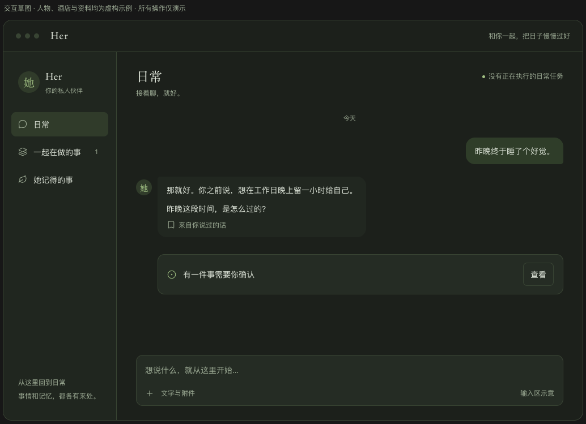
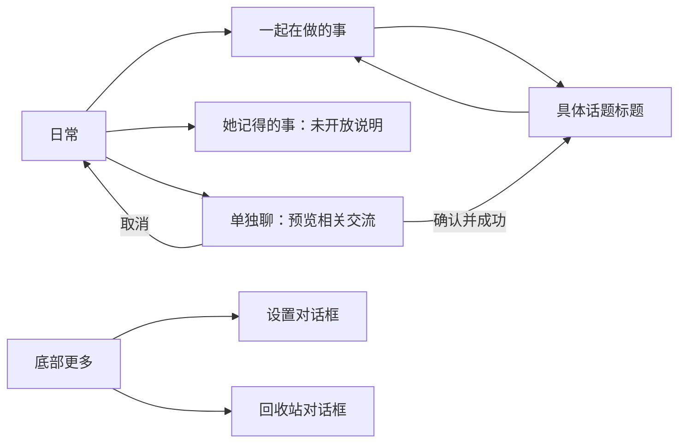

# Her 生活陪伴界面与交互方案

日期：2026-10-23

状态：依据本轮已确认的 UI Q1–Q8、Q13–Q21 及最新范围调整汇总；既有旧对话均为测试数据，本轮不设计其入口、迁移或兼容。遗漏核对已完成并合入既定规则的流程补充，未发现需要新增用户决定的阻塞问题。用户明确要求先不改代码。本文不代表实现、运行验收或记忆能力已经完成。

访谈、原型偏差和源码证据见[访谈记录](../reviews/2026-10-23-private-companion-ui-alignment.md)。遗漏与一致性检查见[核对记录](../reviews/2026-10-23-life-companion-ui-completeness-review.md)。本文编号均指本轮 UI 访谈，与其他记忆或授权访谈的同编号无关。

## 1. 产品重心与方案优先关系

Her 以生活陪伴为主。日常交流、生活里的小事、共同的小打算和持续相处是主线；用户明确需要办事时，相应能力与确认按需出现。

产品名为 Her，内置伙伴身份为 Samantha。头像、语气和视觉应让用户感到是在延续与同一个伙伴的交流；不虚构她的活动、情绪、共同经历或已办成的结果。

本方案整理最新已确认呈现，避免后续实现直接照搬访谈早期建议：

| 早期内容 | 当前有效决定 |
| --- | --- |
| 默认显示事情数量和“没有正在执行的日常任务” | Q14 取代 Q8 的这些呈现：默认不显示；真实待处理按需出现 |
| 卡片铺开多委托数量、任务状态、管理流程 | Q9–Q12 未获接受；以 Q13–Q21 的生活话题、轻量提示及按需详情为准 |
| 新建入口“开始一件事”、空白页强调目标 | 改为“另开一个话题”；可以只是聊，不要求成为委托 |
| “独立话题详情”“一起聊”“我们的小事”固定页面名 | 用户不采用；入口为“一起在做的事”，进入后只显示具体话题标题 |
| 记忆能力完成后才出现第三入口 | Q3 明确调整为可点击的未开放说明页，不开启记忆功能 |
| 第二入口底部提供“以前的对话” | 用户最新说明旧对话均为测试数据，本轮删除该入口及旧会话保留/迁移/兼容要求；Q17 的改名与回收站管理部分继续有效 |
| 现有浅色设计系统 | 本轮以用户原型的深绿视觉为准；字体、间距和控件语义可复用已有规范 |

既有的授权、未知动作、资料来源、历史权威和记忆产品边界继续成立。界面生活化不扩大任何资料使用或执行许可；新增话题衔接也不能绕过这些边界。

## 2. 范围与能力边界

本轮界面设计覆盖公共外壳、日常、一起在做的事、话题页、她记得的事，以及设置、回收站、资料与诊断入口。也包括真实加载/失败状态、草稿与附件切换、普通输入排队和 Q19 的话题衔接。

既有旧对话均为正式使用前的测试数据，不作为本轮兼容、迁移、恢复或继续访问的目标，也不为它们增加页面分组。方案以正式使用的新日常和新话题为起点；之后正常产生的消息持久保存、跨天交流、回收站恢复以及 Q19 从当前日常衔接新话题的能力仍保留。本轮只调整文档，不执行数据删除或重置。

| 能力 | 当前事实 | 设计处理 |
| --- | --- | --- |
| 固定日常、话题选择、通用待处理跳转 | 已有产品链，布局仍沿用旧界面 | 重新布局并保留隔离和定位校验 |
| 办理与授权 | 已有委托和运行能力，完整实机边界见原验收记录 | 需要时展示，不常驻成任务看板 |
| 长期记忆 | 有基础代码，无完整产品调用与控制链 | 第三入口显示“记忆功能尚未开放” |
| 进展带回日常 | 有字段与底层原语，无完整摘要生成、开关和撤回链 | 相关话题说明暂不可用，不提供可操作开关 |
| 从日常预览并衔接新话题 | 未实现完整链；Q19 已纳入本轮设计 | 必须真实创建、保留来源与范围，失败可核实 |
| 自动短标题 | 当前只更新界面，未完整写回持久层 | 标题须真实保存，用户改名后不自动覆盖 |
| 按话题保留未发送草稿与附件 | 当前切换会清空，不能当作已有功能 | Q7/Q20 的实现与验收要求 |

本轮不扩展语音、虚拟世界、主动联系、提醒、真正临时聊天、全文搜索、消息编辑、图片粘贴或编辑、话题归档/置顶/完成。现有回收站批量清理和诊断能力继续保留。

## 3. 视觉基线

参考图为 1034×749 像素，来源为用户附件，已原样保存为文档资源；SHA-256 为 `8be3f1fa224e00115f1c0f00c0a46fb8089b4c736ad293920db5dad19fc4fb62`。图内人物、酒店、消息和记忆均为演示，不写入正式用户数据。

后续颜色修订：用户要求将正式界面颜色回退到 Her 原有的暖白、浅灰绿配色。下图及原型继续作为结构和交互参考，深绿配色不再是当前验收目标；现行颜色以 `docs/DESIGN_SYSTEM.md` 为准。

- 保留侧栏与内容区的细微层次、柔和绿色强调、细边框和充足留白；背景与文字改用原有浅色体系。
- 顶部紧凑 Her 标题栏；可沿用“和你一起，把日子慢慢过好”的静态文案。右上不保留空闲任务栏，也不以虚构活动填补位置。
- 侧栏采用纵向三个入口、简洁伙伴标识和底部文案。设置与回收站收进底部更多菜单；不再放大品牌标识或长会话列表。
- 主区域沿用原型的标题、聊天、待处理卡和底部输入区关系。用户消息偏右，伙伴消息偏左，日期分隔来自真实记录；精确时间可按需查看，不让逐条时间抢占视觉。
- 标题沿用宋体，正文及操作用系统无衬线；代码保留等宽字体。头像可采用原型中的简洁“她”标识，其身份仍为 Samantha。
- 参考宽度下侧栏约 200px、主内容边距约 34–40px，作为视觉细化起点；最终对齐以参考图并排检查为准，不把观察值冒充逐像素合同。
- 窄窗口保持内容单列，表单和长记录内部滚动，输入区及关键操作可达。以参考比例及已有 850×620 验收窗口核对，不新增设备端。

原型中的静态示例对话、“输入区示意”和草图免责声明不作为正式产品内容。日常空状态采用后文已确认文案。

## 4. 页面结构与返回关系

三个主入口始终可达；所有话题共用伙伴身份。打开或关闭辅助面板不结束当前交流。返回日常保持固定日常身份，不因最近进入的话题变化而换成另一段聊天。

### 4.1 日常

日常是默认主场。普通聊天、倾诉、读书、旅行念头等自然留在这里，不因提到目标或小打算就自动生成卡片，也不要求用户整理生活。

页面包含“日常”标题、简短说明、连续聊天及简洁输入框。没有任务看板、事项总数、空闲任务栏或大幅欢迎画面。未有消息时短句为“我在，想说什么都可以。”，不填示例对话、假日期或假回忆。

有真实待确认或需处理事项时，主区域出现轻量通用卡片及查看入口。未共享事项的标题、对象和正文不出现在日常或通知载荷中；点击并重新定位成功后，进入所属话题看完整内容。多个提示只能依据真实状态呈现，不把未知数量当成零或编造处理结果。

### 4.2 一起在做的事

标题下短句为“有些事，可以慢慢一起聊”。单列轻量话题卡呈现真实标题与可用的简短交流线索，不预置示例卡片，不展示进度条、完成率或多委托统计。

一张卡对应一个具体话题，可以只有讨论，也可以包含多个真实委托。委托和一次模型运行都不等于话题；一次回复结束不表示话题完成。

操作入口为“另开一个话题”。空列表显示“还没有一起在做的事”，同时保留该入口；不显示旧测试会话分组或用测试数据填充列表。真实交流线索尚未读取时，可以只显示已有标题，不能编摘要或批量切换选中话题偷取详情。

### 4.3 话题页

页面直接显示真实话题标题，例如“周末去哪儿”；“话题页”只是文档内部称呼。顶部为返回、标题和低调更多菜单，中间为对话，底部为输入。

空白话题提示“这件事，我们从哪里开始？”。日常与话题页的伙伴身份、消息样式和输入方式一致，普通讨论不要求填写目标、范围或完成条件。

明确托付办理后才显示必要的范围、动作或待处理卡。权限请求与相关交流相邻，准确授权内容必须可见；过程与原始记录可以展开，不把所有历史委托卡铺在输入框上方。多个委托分别定位和操作，不能用话题最新的一次任务覆盖其余委托，也不能在不知道具体对象时提供一键全部继续。

仅在确有办理的卡片中区分三种操作：拒绝这一步只拒绝本次具体动作，其余获准部分可继续，也不能换工具重复尝试被拒绝动作；暂缓这件事保留已有进展与原边界，等用户明确继续并重新核对；取消这件事结束对应委托及其授权。操作绑定当前委托，不默认作用于整页所有事项。普通生活讨论不常驻这些按钮。

进展共享尚未可用时，话题以中性文案说明“这里的进展暂不能带回日常”；不出现可操作共享开关。这沿用 Q4 的实际含义，去掉生活话题中的“工作”字样。普通生活讨论也不会自动变成日常可用的记忆。

### 4.4 她记得的事

侧栏第三入口保留并可点击；主区域显示标题和同风格的轻量说明卡：“记忆功能尚未开放”。可返回日常或切换入口。

不展示示例记忆、伪造来源、“还没有记住任何事”、启用/纠正/遗忘按钮或模拟整理进度。它是未开放状态，不是已启用但内容为空。未来启用仍以独立的记忆产品设计与真实控制链为依据，本轮不提前交付。

### 4.5 设置、回收站、资料与对话详情

| 区域 | 入口与布局 | 保留的行为 |
| --- | --- | --- |
| 设置 | 侧栏底部更多；深绿体系居中对话框、内部滚动 | 模型、工具、技能、资料授权、桌面偏好、提示词等现有类别；保存、测试与错误语义不变，未保存配置不能冒充已生效 |
| 回收站 | 底部更多；同风格居中列表 | 恢复、单项/批量永久删除、清理中与失败重试；保留现有确认流程 |
| 当前资料授权 | 从“文字与附件”相关入口就近展开 | 查看对象和范围、实际撤权；读取说明与模型传输解释按需可见 |
| 长期资料授权 | 设置中的现有入口 | 长期目录范围和独立撤回；不因移除一次附件自动撤权 |
| 对话详情 | 当前对话的更多菜单或相关记录展开层 | 用量、压缩、当前模型选择、模型能力与原始工具记录；保留原有空闲切换规则，按真实条件提供诊断或控制 |

关闭面板回到原页面和交流位置，不把修改设置等同切换伙伴。已有密钥不回显，错误不暴露本机路径或凭据；面板异步结果仍须属于当前对象，不能被迟到结果覆盖。

## 5. 输入、附件与回复

### 5.1 输入与新建标题

默认输入区只保留文字输入、文字与附件、发送；回复期间提供停止。沿用 Enter 发送、Shift+Enter 换行，并正确处理中文输入法确认按键。

未配置模型时可以先写文字草稿，提示连接模型服务并提供设置入口；发送不可用。切换成功前、目标读取失败或附件尚未核验时，不能将内容发往不确定的话题。

手动另开话题不先要求填名称，不自动发消息或调用外部工具。首句形成可改名的短标题并真实保存；用户手动改名后不被自动命名覆盖。只有附件或没有可用首句时保留中性的默认标题，不能根据未解析内容臆造名称。

### 5.2 附件草稿

沿用文件选择与磁盘文件拖入。可预览图片显示缩略图，其他文件显示简洁文件条；选择、预览、解析和发送前校验分别表达真实状态，选中不代表可理解或可发送。

未发送文字和附件引用按所属话题保留，切换回来重新核对授权、存在及版本。附件不能跟到其他话题，失效或撤权引用不能被旧预览、迟到选择结果或恢复草稿重新放行。

移除附件仅表示这次不发送，不删除原文件，也不宣称撤销访问。实际撤权入口仍可找到。预览失败就近说明，不把其他正常消息或附件清空；发送失败保留用户输入及可恢复的附件状态，不能暗示已发送成功。

沿用当前真实格式、容量、数量和模型能力校验，不新增全格式解析承诺或降低现有限制。未发送草稿和阅读位置在本轮不承诺跨真正退出或重启持久保存。

### 5.3 回复期间继续说话

她回复时仍可输入和提交下一句。普通新消息以“接下来聊这句”的轻量条目呈现，用户可以撤销排队；只有正常结束且符合原队列规则时才自动接下一条。

停止、失败、来源撤回、服务变化、压缩问题、未知动作或重启后的等待原因应按真实情况说明，并在允许时提供明确继续。不能用一个空队列外观掩盖读取失败，也不能许诺一定会自动续聊。

明确停止或修正已有事务的指令继续优先处理，不排在普通补充之后。停止保留已生成内容；继续当前任务、继续排队和重试纯聊天分别呈现，不把外部未知动作包装成普通重试。撤销排队与任务开始竞态时，要核实真实结果，不能在已开始后仍宣称撤销成功。

消息支持原有文本选择复制、Markdown 和代码阅读。仅在现有规则允许时提供失败/取消后的纯聊天重试，不新增消息编辑、消息级复制按钮或全文搜索。

## 6. 从日常衔接新话题

普通生活交流留在日常。用户主动另开，或接受偶尔且相关的轻量建议后，才进入衔接流程，不反复催促分话题。

日常中的明确办事请求另按既有规则建立或选定所属话题，说明目标和边界，用户可以留在日常交流；不将明确办理强行改成先搬聊天的预览流程。反过来，Q19 的确认只批准保存所展示的衔接背景，不自动发送新消息、触发模型回复或派发外部动作；这些仍需对应的实际输入与授权条件。

| 阶段 | 用户看到什么 | 必须满足的结果 |
| --- | --- | --- |
| 提出单独聊 | 自然建议或明确用户指令 | 不先建卡，不把普通聊天解释成执行授权 |
| 预览 | 准备带入的少量相关交流及其来源 | 范围可理解，不复制整段日常；无法确定相关范围时先澄清，不自作主张导入 |
| 确认提交前取消 | 返回原交流 | 不创建新话题；原记录、草稿和位置保留 |
| 确认 | 明确确认本次展示的衔接内容 | 绑定当次范围；重复点击或丢失回包不能重复创建 |
| 成功 | 进入真实新话题，显示其标题和承接内容 | 内容已保存且来源有效；没有暗中迁移附件授权或形成长期记忆 |
| 失败或结果不明 | 就近说明，保留原交流；可核实状态 | 不把错误视为肯定未创建，不盲目重试；晚回包不强制打断用户后续导航 |

确认已提交后关闭预览或离开页面，不能承诺撤销已经成功的创建；需核实同次操作的最终结果，并保持用户后续导航。只有确认提交前取消才承诺未创建。

带入的交流若包含文件衍生内容、受限记忆、共享摘要或旧服务材料，其原有限制不能因新话题或改写丢失。预览生成、命名和首次模型请求都不能提前将材料交给未经允许的服务。无法可靠划清时不带入相关材料，说明缺少背景，不暗中换服务或扩大授权。

返回日常后仍沿用原日常内容范围；进入话题不等于已把进展带回日常。Q19 是新的完整能力，工程实现需要证明来源关联、真实落盘、幂等创建和竞态处理，不能只做一个跳转按钮。

## 7. 页面状态与可操作条件

| 状态 | 呈现 | 操作边界 |
| --- | --- | --- |
| 正常空内容 | 日常/话题/列表各自的空文案 | 可输入或另开；记忆未开放单独表达 |
| 首次加载 | 公共外壳稳定，目标区域轻量加载 | 不把上一话题消息放到新标题下；目标未核实不能发送、批准或继续 |
| 同页刷新 | 保留已展示内容并标明更新 | 旧状态不作为新的执行批准；刷新失败说明未更新 |
| 读取失败 | 独立错误与重新加载 | 不同时显示空状态；只重读，不重发或重做外部动作 |
| 正在回复 | 轻量真实反馈 | 可写下一句，可按真实条件停止 |
| 等待确认 | 主内容区必要提示或准确确认卡 | 跨话题只通用提示；定位原话题后核对本次对象和内容 |
| 事务已获准、能力未就绪 | 仅在实际需要时解释缺少的系统权限或浏览器连接，并提供对应引导 | 保留进展，返回后真实复核；其他不冲突的交流与获准部分可继续 |
| 暂缓/停止/失败/中断 | 分别说明实际原因，保留已有内容 | 只在服务允许时提供对应继续，不统一写成用户主动暂缓 |
| 动作结果未知 | “结果待核实”及原话题入口 | 先观察/人工处理，不给会重放的普通重试 |
| 状态未读到 | 必要位置说明暂不可用 | 不宣称零事项、空闲、已完成或成功撤销 |
| 待处理入口失效 | “这件事的状态已更新”，刷新提示 | 保留当前页与草稿；不跳进空白新话题 |
| 本地初始化失败 | 启动错误与重新加载 | 不解释为没有历史，不静默重置资料 |

记忆说明页不模拟加载或整理；如果公共初始化失败，仍按公共错误处理，不据此编造记忆读取失败。加载、关闭错误提示或切换页面都不等于取消后台获准任务。

业务批准、macOS 权限和浏览器连接同意分别建立。打开系统设置、复制命令、MCP 连接成功或检查返回不报错，都不表示系统权限已经授予。返回应用后核对能力、目标和既有范围；若必须重启，按既有规则等待用户明确继续。没有授予能力时，跳过依赖步骤或说明无法继续，不将无响应当作同意。

## 8. 管理、窗口与阅读连续性

改名与移入回收站放在话题卡/话题页更多菜单；日常固定标题和入口。改名失败保留原标题并明确反馈；移入回收站前就近确认，涉及运行时说明停止本话题运行、暂停队列及撤销待审批，已经发生的动作不会撤销，也不宣称取消全部委托。

成功删除当前话题后回到固定日常，其他话题不受影响。恢复按原身份供查看，不自动续跑、恢复旧批准或重放动作。永久删除仍只在回收站执行，清理未完成时明确失败和可重试状态；移入回收站、永久删除对话和遗忘记忆不混同，不删除用户原始文件。

返回页面恢复会话内的阅读位置；用户向上翻阅时，流式更新不抢回底部。打开/关闭设置、切换入口、隐藏再显示窗口保留本轮内的草稿归属，不由此建立跨重启草稿保证。

关闭窗口按现有桌面行为隐藏，真正退出再启动默认进入固定日常；未完成工作等待明确继续，不自动重放。隐藏时待处理提醒沿用既有 Tray 与真实通知许可边界，不新增主动联系算法，也不泄露未共享正文。

## 9. 可达性与内容适配

三个入口、更多菜单、文件操作、卡片、对话框和确认按钮支持键盘与可见焦点；对话框管理焦点，关闭后返回触发位置。危险或业务确认按真实动作命名，不能用陪伴式含糊话术代替对象与后果。

长标题、长中文、代码、Markdown 列表、长文件名、多个附件和错误文本可正常换行或在所属区域滚动；不撑出窗口。视觉反馈不能只靠颜色，禁用操作应能说明原因；动效沿用轻量过渡，不以持续动画伪装真实活动。

这些属于已确认原型适配和键盘可达性的落实条件，不增加新的产品模式。

## 10. 验收覆盖

本表规定未来必须观察到的结果，当前没有执行或通过这些验收。

| 场景 | 验收结果 | 依据 |
| --- | --- | --- |
| 与原型并排比较 | 深绿、紧凑标题栏、窄侧栏、三入口、聊天/卡片/输入关系一致；没有大品牌欢迎区 | Q1/Q2 |
| 日常有历史和次日打开 | 固定日常身份，真实消息与日期，不编造共同经历 | Q6/Q15/Q16 |
| 空日常/空列表/新话题/记忆页 | 四种状态分别呈现，记忆未开放不会显示为空库 | Q3/Q6 |
| 打开第二入口 | 真实生活话题卡，没有数量、任务看板和完成率 | Q13/Q14/Q16 |
| 单独话题标题与改名 | 显示具体标题，首句标题保存，手动改名不被覆盖 | Q16/Q17/Q19 |
| 私密话题等待确认 | 日常只有通用卡，原话题定位后才见详情，过期入口不误开 | Q4/Q7/Q8 |
| 话题衔接成功/取消 | 预览少量相关交流；确认后真实落盘，提交前取消不创建 | Q15/Q19 |
| 明确办事与单独聊 | 普通讨论不自动建卡；明确托付沿用已有办理流程，衔接确认不自动发送或执行 | Q15/Q19、既有授权设计 |
| 衔接多次点击/丢回包/离开页面 | 可核实同一次创建，不重复建卡，不被晚回包强行导航 | Q7/Q19 |
| 带入片段有来源限制或换接收服务 | 不能通过新话题洗掉范围或提前交给未许可服务 | 既有来源/记忆基线、Q19 |
| 切换草稿和附件 | 各话题归属正确，回来重验，撤权/文件变化不能由迟到结果恢复可发 | Q7/Q20 |
| 移除附件/撤权/解析失败 | 三者效果区分，原文件不被删除，局部错误不清空交流 | Q18/Q20 |
| 回复时继续说话和撤销排队 | 轻量提示，正常完成才自动接续，开始执行竞态如实反馈 | Q21 |
| 停止、失败、重启及未知动作 | 内容保留，继续含义区分，未知动作不普通重试 | Q7/Q8/Q21 |
| 多委托及普通讨论 | 同一话题可容纳多个委托；无委托也可聊，按需定位操作不串对象 | Q5/Q13/Q16 |
| 拒绝步骤、暂缓与取消 | 三种后果区分，拒绝后不换工具重试，其他获准部分按条件继续 | 既有授权设计、Q13/Q16 |
| 系统权限或浏览器未就绪 | 按需引导、保留进展、返回复核；重启待续，未授予能力不被视为已批准 | 既有交互设计、Q7/Q18 |
| 回收站恢复/清理失败 | 原身份可查看但不自动运行，失败不称已永久删除 | Q17 |
| 面板、窄窗口、键盘、长内容 | 所有入口及必要操作可达，焦点可返回，输入区不被挤出 | Q1/Q7/Q18 |
| 设置和技术信息 | 设置类别、授权、诊断仍可找到，未保存/失败不假称生效 | Q18 |

必须分别记录静态检查、模拟组件、真实 Electron、打包应用和真实服务/系统权限的证据范围。截图保存、功能测试通过或某次审批成功都不能单独证明原型已经还原。未来视觉验收需要使用真实应用，在相同窗口尺寸和受控虚构测试数据下与参考图比较；视觉偏差与能力缺口分别记录。

## 11. 决定追溯与收口状态

| 本轮 UI 决定 | 本方案位置 |
| --- | --- |
| Q1 原型视觉基线、Q2 全界面范围 | §1–§4、§9–§10 |
| Q3 未开放记忆入口、Q4 未完成共享 | §2、§4.3–§4.4 |
| Q5 一话题多个委托 | §4.2–§4.3、§5.3 |
| Q6 四类空状态、Q7 加载失败草稿 | §4、§5、§7 |
| Q8 真实状态、可操作条件 | §5.3、§7–§8；常驻计数和空闲栏由 Q14 取代 |
| Q9–Q12 | 未接受，不作为独立需求；后续重写后已确认的部分按新编号追溯 |
| Q13 生活话题、Q14 淡化任务感 | §1、§3–§4 |
| Q15 另开触发、Q16 列表及具体标题 | §4–§6 |
| Q17 话题管理、Q18 简洁输入与辅助面板 | §4.5、§5、§8；旧会话入口部分被最新范围调整取代 |
| Q19 预览衔接与真实标题 | §5.1、§6 |
| Q20 附件归属、Q21 回复期间的新输入 | §5.2–§5.3 |
| 最新范围调整：旧对话均为测试数据 | §1–§2、§4.2；不保留旧对话入口或提出迁移兼容要求 |

目前已确认的决定已经汇总，原型未覆盖的页面也有完整呈现边界。视觉稿、工程接口、来源保存、失败恢复和实机验收仍需后续工作；不能把文档汇总或遗漏检查当作实施完成。用户要求先不改代码，本轮仅文档与原型证据归档，不生成代码改动、提交或运行验收结论。
