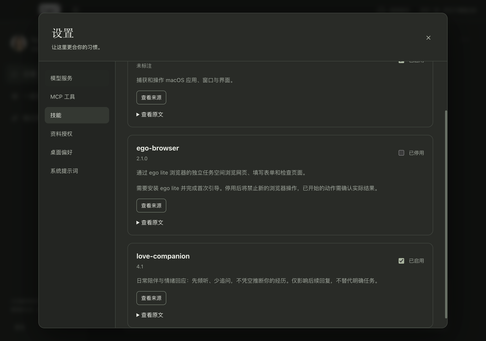

# love-companion 本地集成试用

日期：2026-10-24。用户已授权集成，随后选择“先看集成结果，暂不对比”。

## 如何查看

1. 完全退出并重新打开从当前源码运行的 Her，让主进程加载新内置技能；开发时使用 `npm run dev`。
2. 进入 **设置 → 技能 → love-companion**，默认开启，可查看来源和原文。
3. 正常在日常或话题里发送消息；开关影响后续请求，已经开始的回复不会重启。关闭即可回到原有技能组合，无需修改自定义提示词。

这次只更新源码和构建产物，没有替换已安装的 Her.app。

## 集成范围

沿用现有内置技能注册、启停、持久化和提示词装配，没有增加服务、执行上游脚本或改动记忆与工具权限。启用时包含核心规则及它直接引用的情绪识别、表达风格两份参考文档；保留用户自定义提示词，并加上 Samantha 身份、明确任务照常处理、不得编造用户经历或自行新增记忆的适配约束。

所有内置技能仍受既有模型窗口预算限制；小窗口可能省略技能，可通过系统提示词预览和“最近实际使用”核对实际注入内容。技能是表达指导，不能据此保证每个模型都遵从。

上游固定于 `572444dc50e2a49137ab8f71e31cecebf0256543`，原始文档保持逐字节一致。[来源与文件校验清单](../../../src/core/skills/love-companion/SOURCE.md)记录了版本和许可情况：上游 README_CN 声明 MIT，但此提交没有独立 LICENSE 文件，发布分发前仍需核对补齐。

## 已完成的验证

- `npm run check`：类型检查、构建通过；90 个测试文件通过、3 个跳过，1393 项测试通过、4 项跳过。
- `tests/love-companion.test.ts`：真实 Host/Pi SDK 向本地模拟服务发送请求，确认启用／关闭／重新启用后的系统提示词内容，以及自定义提示词保留。这证明请求装配，不证明真实模型效果。
- `npx playwright test tests/e2e/skills.spec.ts`：1 项真实 Electron 测试通过，覆盖默认开启、原文查看、关闭持久化、重启后恢复及重新开启。截图来自该次验收。
- 上游 5 份原始文档 SHA-256 与固定提交一致；`git diff --check` 通过。

## 暂未完成的验证

真实模型对比在第一条请求发送前因现有加密凭据解密失败中止，没有获得模型回复，没有对话效果或质量结论。没有修改原服务密钥、用户历史或安全存储方式。按用户选择，本轮不再进行模型对比；[失败记录](failure.txt)只保留错误原因。
