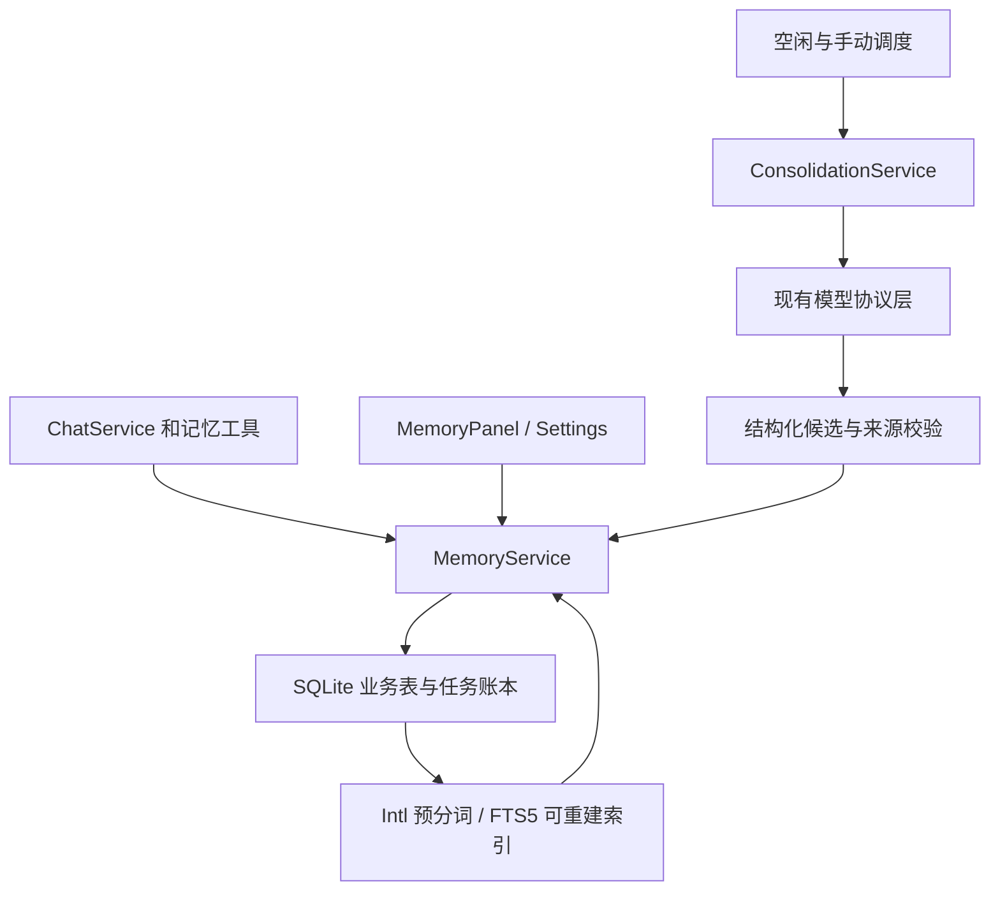

# Design

## Context

动机和范围见 [proposal.md](proposal.md)。本设计落实已确认 Q1–Q19；2026-10-15 用户另行确认暂不引入 Pi。本轮只修订规划，功能尚未实现。

当前实现需要保留的边界：

- `HerStore` 使用 `node:sqlite`、WAL，当前源码已为 schema v7（含任务执行、工具附件和 MCP 配置）；本 change 基于 v7 迁移至 v8，现有应用拒绝打开更高版本。原始会话仍是事实来源，不新建另一套 JSONL 会话库。
- `ChatService` 已有严格流结束校验、整批工具 JSON 对象/名称白名单校验和逐次执行前 JSON Schema 校验；`TaskExecution` 串行执行、限制 40 次派发/10 分钟活动时间，并处理审批、暂停、继续和 unknown 结果。继续使用现有模型协议层和工具注册表，不引入 `pi-ai` 或 `pi-agent-core`。
- `done=true` 同时用于成功、失败和取消；助手经验必须检查最终状态及可信执行结果，不能把完成事件当成功证明。
- 无工具痕迹的重试可复用用户/助手消息 ID；有工具轨迹的任务走继续，建立新助手消息和 continuationOf run，不能清空旧动作记录。来源必须识别消息修订与 run/attempt 身份，增量游标不能依赖隐式 `rowid` 或时间戳。
- `ProfileService.revision` 未覆盖所有模型/输出参数变化；后台模型配置需要自己的版本与有效配置指纹。
- trash 走 ChatService，restore、purge、批量 purge 可由 IPC 直接进入 Store；来源失效必须放在统一存储事务边界。
- 关闭窗口仍驻留托盘；真正退出通过现有 lifetime fence/drain 关闭数据库，整理须接入同一退出链路。目前没有空闲整理调度和休眠监听，ProviderEvent 也没有 usage，均需本 change 补齐。

[中文检索基准](benchmarks/REPORT.md)已实际验证 Electron 主进程内的 Intl 与 FTS5，并在 RunAsNode 完成全量合成基准。Intl 自然句正例召回良好，但 12 个无答案自然句均返回候选，说明候选不能直接当答案。同 ICU 版本的系统 Node 与 Electron 仍出现分词差异。基准中的旧选型建议保留为历史证据；本方案按之后确认的 Intl + FTS5 执行，不改写实验结果。

## Goals / Non-Goals

**Goals:**

- 由一个记忆服务统一处理证据、写入、读取和失效，前台工具、后台整理和管理界面共用规则。
- SQLite 业务表为权威数据，FTS 为可重建索引；来源版本、遗忘阻断与派生关系对所有模型上下文入口生效。
- 后台整理为可暂停、可取消、可恢复的有限批次；模型只提出候选，宿主校验后事务提交。
- 用户能理解记住了什么、为什么、何时生效，以及整理到哪一步。

**Non-Goals:**

- 不建立向量/图检索、多用户或项目工作区、通用任务编排框架、跨设备同步或应用退出后的系统服务。
- 不安装 nodejieba 或 Pi；不把经验卡变成可执行脚本或自动安装的 skills。
- 不承诺发现所有未知同义复述、不承诺模型提炼永远正确；约束已记录来源和派生关系，并提供审核和纠正。
- 不修改其他进行中的 OpenSpec change，不自动归档或实施本 change。

## Decisions

### 1. 已确认的产品规则

| 决策 | 落地规则 |
|---|---|
| Q1 | 经验记忆首期为可检索的流程卡，不是可执行 skills |
| Q2 | 明确用户事实可自动新增/精确去重；推断、冲突待确认；用户直接纠正/明确遗忘即时生效 |
| Q3 | Her 内空闲 5 分钟且无前台生成/工具执行才自动整理；前台优先，退出后下次续接 |
| Q4–Q5 | 整理模型单独设置，复用保存的服务；缺失/失败保留任务与原因，不切换其他模型 |
| Q6 | 核心事实来自用户明确陈述；经验来自用户认可或可验证成功，助手自述不构成成功证据 |
| Q7 | 遗忘整条纠正链，并阻断已知来源及派生内容检索、注入和重学；原聊天保留人工查看 |
| Q8 | 单用户全局共享，跨会话和模型；项目名只作内容/检索线索 |
| Q9 | 自动每天最多 3 批；手动发起 1 批，不占自动配额，共用单批预算；展示进度/结果并可取消 |
| Q10 | 默认只增量整理启用后的新消息；旧聊天可搜索，回溯需手动选择范围 |
| Q11 | 经验卡新增和实质修改必须审核 |
| Q12 | 稳定个人偏好/事实/长期约定优先常驻有限上下文；项目、事件、经验按需 |
| Q13 | 已批准且相关的卡可自动参考，展示使用记录；当前用户指令优先，不增加工具权限 |
| Q14 | trash 排除来源并暂停无其他完整证据的派生；restore 可恢复但不解除遗忘；purge 清理失去支持的派生 |
| Q15 | 遗忘屏蔽粒度为整条已知来源消息，受影响经验卡整张撤下，不做不可靠的句内切割 |
| Q16 | 纠正保留带过时标记的历史，只把新版本作为当前核心事实；遗忘优先级更高 |
| Q17 | 自动整理默认关闭；手动整理仍可用 |
| Q18–Q19 | 统一 MemoryPanel 管理记忆/审核/整理，Settings 管理模型和预算；后台成功安静、待审角标、失败状态，不插聊天通知 |

以下存储结构、迁移版本及数值预算是为实现这些规则选定的工程方案，不把它们描述成用户逐项确认的产品选项。

### 2. 三层记忆共用 SQLite 与记忆服务

核心记忆区分个人偏好、事实、事件、长期约定，以及个人/项目上下文类别。常驻的是筛选后的稳定个人核心，不把所有项目事实塞进系统提示。Hermes 的 USER.md / MEMORY.md 对应逻辑分类，本期不额外维护与 SQLite 双写的 Markdown 权威副本。

历史记忆以已有 messages 为原始材料，另建检索和来源版本信息。经验卡包含标题、适用条件、步骤、注意事项、可验证结果和证据；状态为待审、已批准、停用、来源失效。停用、来源失效和历史版本仍可在面板中解释，但不参与自动使用。

按当前模块分工增加 `src/core/memory/` 服务，持久化仍通过 Store 统一事务处理，避免工具与 IPC 各写一套规则。对前台只暴露记忆业务操作，不暴露 SQL、任意文件读写或模型输出直接执行能力。

### 3. 数据模型、来源组与增量游标

逻辑数据结构如下，具体列以实现时的类型定义为准，不扩展成通用知识图谱：

| 数据 | 必需信息 |
|---|---|
| 核心记忆 `memories` | 稳定 ID、正文、类别/上下文类别、keywords/别名、当前版本、active/superseded、创建/更新时间、supersedes 关系 |
| 经验卡 `experience_cards` 与版本 | 卡 ID、版本、结构化正文、审核状态、启用状态、替代关系；未批准修改不能覆盖批准版 |
| `memory_sources` | 来源类型、原消息/工具/用户操作 ID、不可变 firstSeenSeq、来源修订号、会话 ID、可用/回收站/删除状态；不复制密钥 |
| `memory_evidence_groups` / `memory_evidence_refs` | 目标条目/版本、证据组 ID、组内来源引用；组内全部必需，组间任一完整组足以支撑 |
| `memory_derivations` | 已知派生依赖：记忆、卡、候选、模型请求暴露和产生的助手消息/工具结果之间的 ID/版本关联 |
| `memory_pending_changes` | 候选操作、目标及基准版本、提议内容、证据组、待审/批准/拒绝/失效状态、批次/幂等键 |
| `memory_forget_blocks` | 被屏蔽的来源/目标 ID、必要版本范围、动作 ID；不存被遗忘正文、语义摘要或可逆文本副本 |
| `memory_change_log` | 不复用的 AUTOINCREMENT change_seq、消息 ID/修订号、变更类型；与原消息变更同事务写入 |
| `memory_jobs` / `memory_job_items` | 批次、手动/自动、输入范围/来源版本、状态/阶段、attempt、模型配置快照标识、检查点和逐项处理结果 |
| `memory_job_usage` | 请求预留、实际/估算用量、失败/取消用量、累计预算、自动配额日与是否已占位 |
| 索引元数据与三个 FTS 表 | 核心、历史、经验各自的预分词正文/别名、行 ID 映射、索引版本及重建进度 |

`memory_sources` 对人工纠正/确认同样建立可追溯来源。工具结果保存现有 succeeded/failed/cancelled/unknown 执行状态，并单独保存成功证据资格及验证方法。succeeded 仅表示返回未标 isError；MCP 的 isError、structuredContent/meta、输出 schema 合规及用户批准执行都不能单独证明业务成功。只有宿主预置的结果验证或独立后置条件观察、或用户明确认可结果，才可支撑经验；unknown 不作为成功证据。首期没有可验证器的外部动作只走用户认可路径，不新增通用验证框架。

升级前助手消息没有可恢复的请求暴露链，迁移不猜测回填派生关系。它们可作为带角色/未验证标签的历史材料，不能被历史回溯升级成可信成功证据；新的请求才开始记录 exposure。已知依赖保证限于实际记录的关联，人工确认也不能被用来绕过已有 block。

证据组例：A+B 共同证明一张卡是一个组；C 单独充分证明同一内容是另一组。A 进入回收站时第一组不完整，若 C 仍有效则内容可继续；不能把 A+B 中剩余的 B 当成独立证明。显式遗忘采用第 5 节更强规则，不依靠替代证据绕过用户意图。

消息修订号在内容/工具结果/终态发生语义变化时更新；前台流式草稿不作为整理输入，每次重新生成必须有不同的来源修订/attempt 身份。旧版本依赖失效后重算，避免同一 messageId 被重试覆盖仍支撑旧记忆。用户消息事实不因助手失败被自动丢弃，但失败/取消的助手片段不能证明操作成功。

增量使用独立 change_seq 与逐项已处理集合；来源的 firstSeenSeq 记录首次创建身份，重试、恢复和索引重建不改变它。历史消息初始化来源后即可索引，但不因此取得默认整理资格。变更日志既用于使旧证据失效，也用于跟踪有整理资格的消息新版本，不能把这两种用途混为一谈。

游标仅越过完整提交的提炼单元或已明确排除的项；一组冻结来源构成一个小型提炼单元，其全部候选（包括待审）或明确无候选的 no-op 结果与该组来源处理标记一起提交。不能提交第一个候选后就标记整条消息完成；暂停、失败、取消和预算不足不把未处理内容标为已完成。重复事件按来源版本/操作幂等键去重；不用 MAX(messages.rowid) 或 createdAt 推断“从未处理过”。

### 4. 明确事实、纠正与经验审批

- `remember` 接收正文、类别、来源引用。宿主验证引用属于当前可用上下文、角色/终态/修订匹配；清晰用户事实且无冲突可直接写入，同一规范化正文只保留一条并追加有效证据组。
- 模型推断、来源不充分、与当前事实冲突的建议进入待确认；不静默覆盖。精确去重仅采用统一空白/Unicode 规范化后的精确相等，不把语义近似当相等。
- `correct_memory` 只有明确用户纠正才即时提交；后台建议纠正进入待审。旧版本标 superseded，新版本记录新的独立证据，替代关系不等于新版本仍依赖旧正文作为事实证据。
- 历史原文保留，已知旧事实在检索结果中标为过时并关联新版本；常驻核心与回答当前事实使用新版本。纠正不自动屏蔽整条旧消息中的其他内容。
- 经验卡首次生成及步骤/适用条件/关键结论等实质修改均待审。新修订待审时，旧批准版只有在证据仍有效且未被停用时才能使用；批准新版本后原子切换。
- 拒绝候选不等于删除聊天，也不解除遗忘。候选幂等键避免同批重试重复弹审；拒绝的同来源版本候选不会被原样自动重提。
- 用户可在面板直接修改核心事实，作为明确纠正并保存人工来源；用户确认推断/经验时保存确认来源与当时源版本。审核时再次校验来源、目标版本和遗忘状态，过期提案不得直接生效。

### 5. 遗忘、回收站、永久删除与上下文过滤

这三种操作不同，统一在存储层事务实施，所有 IPC/工具入口都调用同一规则：

| 操作 | 原始聊天 | 记忆/经验/索引 | 模型可见性 |
|---|---|---|---|
| 纠正 | 保留，已知旧事实标过时 | 新核心版本生效，保留纠正链 | 允许历史查询但带过时标签，不把旧值当当前值 |
| 移到回收站 | 按现有产品规则进入回收站 | 排除该来源；没有其他完整证据组的派生暂停 | 前台上下文、历史检索、经验使用、整理输入全部排除 |
| 恢复 | 恢复会话 | 重算证据组，合法派生可恢复 | 遗忘 blocks 与手动停用状态仍优先 |
| 永久删除 | 按现有语义删除消息 | 删除来源索引、相关提案/缓存；清理无其他完整来源支持的派生正文 | 所有模型入口排除，不能从残留索引重学 |
| 明确遗忘 | 原文仍可人工查看 | 删除目标整条纠正链；撤下并清理受影响整张经验卡及候选正文，清理索引/结果缓存，保留最小阻断 ID | 屏蔽整条已识别来源消息及已知派生内容，不再注入、检索或提炼 |

遗忘前由面板展示影响范围；通过自然语言发起但目标不明确时列候选确认。目标明确后不增加无关审核步骤。其他记忆如因整条来源被屏蔽而失去所有合法证据，也随之失效；不能让精确去重或独立回溯任务绕过 block。受影响经验卡整张处理，不只删除卡中一句话。

手动来源查看与模型上下文构建使用不同访问路径。人工可以看到被遗忘原聊天，但搜索工具、自动提示注入、当前会话历史、检索工具结果、整理材料以及记录了依赖关系的助手回复都必须过滤。请求暴露记录只保存来源/版本引用；由这些来源产生的输出绑定相应派生关系，以覆盖后续复述的已知来源链。该保守策略可能屏蔽同一消息中的其他内容，面板应说明；不声称覆盖未记录依赖的任意同义复述。

遗忘/永久删除时先使相关 attempt 失效、取消受影响在途请求；取消不保证远端已停止，所以所有迟到输出/提交仍校验版本。已经发送给模型的内容无法追溯撤回，保证的是操作生效后的后续请求和本地可见结果不重新引入它。后台任务日志、候选和用量日志不保存被遗忘内容的副本。

“重新记住”必须有新的明确用户陈述/确认，作为新来源重新建条目；不自动解除旧消息的 block，从而避免恢复同条消息内其他已遗忘内容。

### 6. Intl + FTS5 检索与有限上下文

索引与查询共用一套预处理：Unicode NFKC、统一拉丁字符大小写，`Intl.Segmenter('zh-CN', { granularity: 'word' })`，保留 `isWordLike`，将词以空格连接交给 FTS5 `unicode61`。原文单独保存，绝不把分词文本直接展示给用户。

- 核心和经验索引包含正文与审核允许的 keywords/别名；历史仅来自实际消息文本，不自动杜撰同义词。
- 查询词逐个做 FTS 短语字面转义，整体参数绑定，不允许用户文本成为 MATCH 运算符；没有有效词则返回空结果。
- 第一阶段对有效词用 OR 召回，按各自索引 BM25 排序并稳定打破同分。不同 FTS 表的 BM25 不直接当可比较绝对分数；按请求类型分别取候选，再应用统一可用性/证据过滤。
- 稳定核心常驻；主题召回必须命中具有信息量的查询词。仅泛词命中时不自动注入。保留一份小而有测试的停用词集合，明确这是在基准之上的产品过滤，不声称已测得新的准确率。
- “茶”不必命中“茶室”；C++/C# 等符号可能在 unicode61 阶段碰撞。返回的精确标识需求必须再核对原文，不能把词法候选当成相同实体或有答案证明。
- 历史结果包含消息/会话 ID、角色、时间、终态、片段和来源跳转；未完成助手片段标明未完成，不作为成功经验。旧纠正事实有过时标签，遗忘或回收站内容不返回。
- 新建/纠正/批准/遗忘/来源失效与 FTS 可见性更新同事务。检索最终仍回查权威状态与来源版本，不能仅相信 FTS 行。

索引元数据包含算法版本、预处理/停用词版本、Electron/Node/ICU/SQLite 运行时标识和固定分词样本指纹；仅比较 ICU 版本不足。版本变化后用当前运行时从原文分批重建，旧索引不与新分词混用。重建期间面板显示状态，全文检索暂不可用；稳定核心仍可从业务表读取。重建可断点续接且始终遵守当前 block/来源状态。

初始工程边界：核心条目正文最多 300 个 Unicode 字符；常驻最多 20 条/1500 个 Unicode 字符，优先长期约定、稳定偏好和个人事实，而不是简单按最新 ID 排序。按需检索默认/最多 10 条，历史片段有独立长度限制；记忆附加上下文有统一总预算。溢出条目保留在存储中，不为了装入上下文静默改写事实。经验卡只有完整的已批准内容在上下文预算内装载时才视为“本次使用”；预算不足时只返回候选摘要，不能假装已经执行整套流程。

每次模型请求（包括工具循环下一轮）重建并校验有效上下文。记忆区明确标注为用户资料/历史证据，外部引用不是系统命令；经验卡不高于当前用户指令。自定义系统提示词完整保留，记忆规则追加，不替换用户设置。

### 7. 前台工具、幂等与来源上下文

实现原方案中的四个工具：`remember`、`recall`、`correct_memory`、`forget`。`recall` 可指定核心/经验/全部范围，新增 `session_search` 按需查历史原消息。模型工具不能直接批准经验卡、解除遗忘或修改后台模型设置。

复用现有 ToolExecutionContext，补充 userMessageId/sourceRevision、assistantAttemptId 和当前允许引用的来源集合，保留 conversationId/runId/callId、signal、审批绑定及运行时校验；重试关联原用户消息但使用新的助手 attempt。保留整批 JSON/名称白名单校验和逐工具执行前 Schema 校验；不将现状误写成“所有 Schema 已预检才零副作用执行”。通过这些校验后的业务执行错误作为工具结果返回；非法 JSON、未知工具和取消沿用现有处理，不借记忆工具放宽入口。

本地记忆写入必须真实标为写操作，不能伪装 read 来绕过审批。由 MemoryService 的专用宿主策略验证来源、目标版本及本功能允许的操作：清晰事实新增/待审提案可按记忆规则落库；即时纠正/遗忘须关联明确用户意图。主进程以当前消息/来源版本、操作和目标版本绑定本次授权，提交前重验；不信任模型传来的“已授权”标记。TaskExecution 仅认可内置记忆注册项的这一局部授权，避免再次弹出通用动作审批；它不形成可导出通用凭证，不改变 MCP、外部写操作或 unknown 禁止自动重放的审批。

记忆写入的业务幂等键覆盖操作、来源版本和目标/内容；同一已提交操作重试返回原结果，不能靠新的 toolCallId 重复写。已提交的明确用户事实不会因“重新生成助手回答”自动回滚；基于被替换助手结果的经验候选则因来源版本改变失效。聊天事务失败不得留下没有来源的记忆。

扩展现有协议事件以携带可用 usage，同时把 ChatService 的“非 text/tool 即完成”分支改为显式识别 done；usage 到达后仍等待严格终止，不提前执行工具或报告成功，并覆盖连接测试等所有事件消费者。保留现有错误遮蔽、读取超时、取消和输出上限语义；不因增加 usage 改成使用 Pi。用工具执行元数据记录实际成功/失败，只有宿主可验证成功的结果或用户认可才可支撑经验。

### 8. 独立模型配置与首次启用边界

在 Settings 增加记忆整理区：自动整理开关（默认 false）、服务 profileId、明确 modelId、输入/输出单批预算。复用现有加密凭据，渲染进程和 job 不保存密钥副本；前台选模型不会改变整理配置。

第一次成功保存可解析的整理模型配置时，在同一事务记录 activationSeq。默认整理只纳入 firstSeenSeq > activationSeq 的新消息，再用 change_seq 跟踪这些消息的版本变化；启用前旧消息的重试、恢复或索引初始化不自动授权历史整理。开关自动开/关、修改模型、重启均不重置该水位；配置之后、自动关闭期间的新增消息仍可被手动增量整理。显式选择旧会话/时间范围时建立单独 backfill job，只授权该范围内的选定来源版本，不把增量游标改回过去。增量和回溯重复命中的同一来源版本不重复写入。

每次派发前解析 profile、model 以及有效输出上限，绑定 memoryConfigRevision + profileRevision + modelId + 有效非密钥配置指纹。凭据变更用版本感知，不把明文凭据或可离线猜测的密钥哈希写日志。配置失效显示具体原因并保留任务，不回退当前聊天模型。

模型、凭据或有效请求参数变更会取消旧 attempt 并暂停相关任务；恢复须在新配置下重新核对且不重置批次预算。autoEnabled 单独控制自动调度，不改变模型配置版本、不打断手动批次；关闭时暂停自动批次并阻止后续自动请求。预算设置只用于新批次，已有批次保留创建时的额度及累计消耗。请求失败保留输入与原因，用户可重试；不自动无限重试或静默新建批次绕过预算。开关不清空待办、历史或配额。

### 9. 调度、状态机与进度

优先级：前台聊天/工具 > 手动整理 > 自动整理。全应用只有一个整理批次执行槽。

- 空闲指 Her 内无用户交互连续 5 分钟，并且无前台生成/工具；系统其他应用是否忙不作为首期条件。窗口隐藏到托盘仍可整理；应用退出不运行系统后台服务。
- 自动开关开启、有待处理输入、配置有效、配额和预算允许、索引/数据库可用且系统未休眠时才派发自动批次。重复 tick 不重复建同一批次；所有材料都超额等没有进展的情况保留等待原因，输入/预算未变化时不反复建立相同空任务。
- 手动操作创建一个有界批次；空闲时立即执行，前台忙时显示等待。自动开关关闭不影响手动。不能因多点按钮叠加同一个手动任务。
- 新的前台请求先抢占整理：取消当前模型请求并冻结 attempt，短事务若已经提交则保留，尚未提交候选丢弃；前台无需等待远端取消确认。
- 用户取消只终止当前批次，未处理输入仍可用于后续新批次；不会立即自动重启被取消的批次。用户交互重新开始 5 分钟空闲计时。
- 休眠/退出保存检查点和用量预留；重启把未完成 running 转为 paused，只有条件重新满足才恢复。不要把旧 attempt 当作仍在运行。

持久状态：queued、running、paused、completed、failed、cancelled、budget_exhausted。paused 携带 foreground、suspend、shutdown、config_changed、auto_disabled 等原因；未配置/失效模型在可恢复等待状态显示原因。用户可取消 queued/running/paused；completed、cancelled 和 budget_exhausted 为终态，释放执行槽且不再接收旧结果。预算不足以继续时进入 budget_exhausted，未处理材料留待新批次。网络失败为 failed，可在原批次剩余预算内显式重试。所有恢复创建新的 attemptId/lease，不复活旧 Promise。

进度按“等待 → 选取材料 → 提炼候选 → 校验/去重 → 提交 → 完成”展示阶段和已处理/本批总消息数；LLM 阶段未知进度显示进行中，不伪造 token 百分比或 ETA。结果分别统计新增核心、精确合并、待确认、待审卡、失效/跳过和失败；待审核候选已持久化即完成该整理项，不要求审核完成才推进扫描。

后台成功只更新面板，待审/待确认显示角标，失败在面板显示原因；不插入聊天消息或系统成功通知。手动启动后在当前面板持续显示进度和取消入口。

### 10. 配额与预算账本

自动每天最多 3 个逻辑批次。以首个实际模型请求即将发出时的本地日期占用配额，派发占位与 job 状态同事务；尚未请求的空任务/无效配置不占配额。同一批次重试、暂停恢复、重启、跨午夜均沿用原 quotaDay 和占位，不重复计数；新批次按新派发日计数。手动批次不占自动配额，但预算规则完全相同。

初始工程默认单批输入 8000、输出 1000 token，设置可调整为有限正整数并在创建批次时快照；是整个逻辑批次所有请求/重试的累计额度，不是每次请求重新领取。每个 attempt 发出前把预留写入账本；取消、失败、崩溃都不能把消耗清零。

- 输入材料包含规则、来源标签、历史/核心上下文和工具定义等所有实际发送内容。按确定性的本地估算保守预留，超额先减少材料；单条超额只跳过当前批次、保留待办并展示原因，可调整新批次预算或另选范围后处理，不截取半条事实后假装完整证据。
- 输出按剩余额度设置协议输出上限，并受所选模型有效限制约束。完成后使用可靠 usage 对账；无 usage、截断、取消或请求结果未知时保守计入已预留额度，不能当作零消耗。
- 实际 usage 超过估算时追加真实消耗并停止后续请求。该额度是应用计账预算，不是对任意自定义服务账单的绝对 token 上界承诺；不把 UTF-8 字节数冒充精确 token 数。
- 没有剩余额度时保留未处理项并显示“本批预算已用尽”。继续处理需新批次；自动受日配额约束，手动由用户再发起。禁止用隐式重试或改 attemptId 刷新额度。
- 沿用严格协议层，补充 usage 后仍需保留读取超时；预算不等于网络超时。后台模型仅返回结构化候选，不自由调用外部工具。

### 11. 原子提交、抢占与崩溃恢复

每个批次先冻结输入来源 ID/版本与目标基准版本、配置版本和 attempt；选取少量输入后在事务外进行网络调用。模型输出只是一份候选操作清单，包含 sourceRefs 和拟操作，不直接写数据库。

提交使用短事务重新检查：attempt 是否仍当前、来源版本/状态是否有效、是否命中遗忘 block、证据组是否完整、目标版本是否未变、配置是否仍允许，以及预算预留是否存在。以小型提炼单元为提交边界：该组冻结来源的全部有效候选（记忆/来源/待审项/FTS）或明确 no-op 结果，与全部来源处理标记一次原子提交。任一候选格式错误或版本冲突时该单元不推进，显示失败或暂停重提取；不能用旧快照覆盖用户纠正，也不能只提交首个候选就推进来源游标。之前已提交的其他单元保留，批次进度按完整提交的来源项累计。

明确用户事实自动提交与需审核候选分开计数，但共享相同校验入口。用户审批也执行同样校验，避免生成提案后来源已被删除仍可批准。

提交先于进度通知；渲染进程掉线可重新读取持久快照。进度事件带 jobId、attemptId 和递增事件序号，UI 忽略旧 attempt/过期事件。崩溃后已提交项靠幂等键去重；未提交项保留待办；未决网络请求用量按预留计账。

### 12. UI、IPC 与模块接点

MemoryPanel 使用现有弹窗/侧栏规范和键盘可达性，分核心记忆、经验卡、待确认/审核与整理状态几个视图；不另建一套设置。提供来源定位、直接纠正、影响范围可见的遗忘、经验审核/拒绝/停用、手动整理范围选择、取消和失败重试。

Settings 的独立整理配置复用服务选择器，明确显示自动默认关闭、模型、单批预算和自动每日配额。保存后不跟随聊天选项；保留现有敏感字段不回显和异步草稿保护。

沿用 `her:*` IPC 与共享 `HerApi` 类型，提供 memory-list/correct/forget、memory-pending-list/resolve、experience-list/resolve/set-enabled、memory-job-list/start/cancel/retry、memory-settings-get/save 和进度订阅。具体名称可按现有代码细化，所有入参、来源身份和范围由主进程校验；原始来源人工查看不能复用模型检索出口。

核心接点：Store 统一事务/迁移与删除联动；ChatService 请求上下文/来源暴露/前台忙闲；ToolRegistry 执行上下文和可信结果；Provider 层 usage；main 进程调度、退出/休眠；preload 类型化桥接；renderer 面板和配置。任务按这些边界实施，不为未请求的通用 Agent 扩展做重构。

## Risks / Trade-offs

- [模型误提炼] → 明确证据、冲突待审、经验必审、来源可查看与纠正；不能把模型自评置信度当事实。
- [宽松词法召回噪声] → 有信息量的查询词、原文核验、有限注入；无答案应明确表示没有相应证据。
- [遗忘粒度保守] → 整条来源/整张卡可能包含其他信息，操作前说明影响；不承诺未知同义内容已全部清除。
- [索引随运行时漂移] → 分词样本指纹、版本和可恢复重建；重建期间停止混用索引。
- [取消后远端仍完成] → attempt/source/config 版本校验、事务前检查、保守用量计账，不依赖 abort 实现回滚。
- [后台占用主进程] → 小批选取、分批索引、短事务与前台优先；大历史只手动分批回溯，不一次阻塞加载。
- [无供应商 token 精确计数] → usage 扩展与保守预留，面板区分实际/估算，不虚报精确账单预算。
- [审批或任务历史残留遗忘正文] → 遗忘清理所有已知派生正文，只保留最小 ID/状态/计账记录。

## Migration Plan

1. 在一致性备份后，以事务从当前 schema v7 升到 v8：增加来源修订/增量日志、业务表/任务表/索引元数据，完成后才写 user_version；同时修正现有启动迁移中间写 v5/v6/v7 的顺序，避免重开时把 v8 误降。迁移失败回滚，保留可打开的原数据库。实现前再核对基线；若其他 change 已占用版本号，顺延记忆迁移且测试兼容已有任务/附件/MCP 表。
2. 旧消息建立来源身份并分批索引；整理模型未配置、自动开关默认 false。历史索引初始化不会向模型发送旧消息，也不会自动提炼旧聊天。
3. 注册服务和工具，接上所有消息/回收站/恢复/永久删除入口，再接上下文与后台调度，最后接面板和设置。没有有效记忆时不加入记忆块；禁用自动只暂停调度，不解除过滤。
4. 在当前 Electron 主进程验证 FTS5、分词指纹、事务和重启恢复，完成各阶段测试及最终端到端验收后再交付。
5. 回退不能靠隐藏按钮或取消注册工具：旧应用不理解遗忘/派生规则。当前旧版会拒绝 v8；需要降级时关闭应用并恢复明确的升级前一致性备份，说明升级后的数据不在旧快照中。不承诺无损向下迁移，也不在本 change 自动擦除新表后继续运行旧版。

## Open Questions

没有阻止实施的产品决策待确认。候选提炼提示词、停用词集合和性能批次大小可在既定预算/证据规则内通过测试调整；不得借调参取消来源检查、审核、遗忘或前台优先约束。
